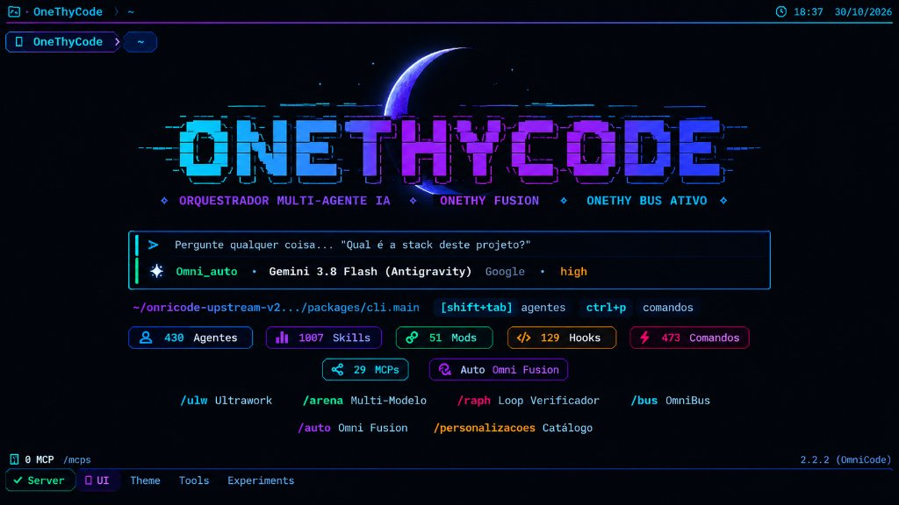
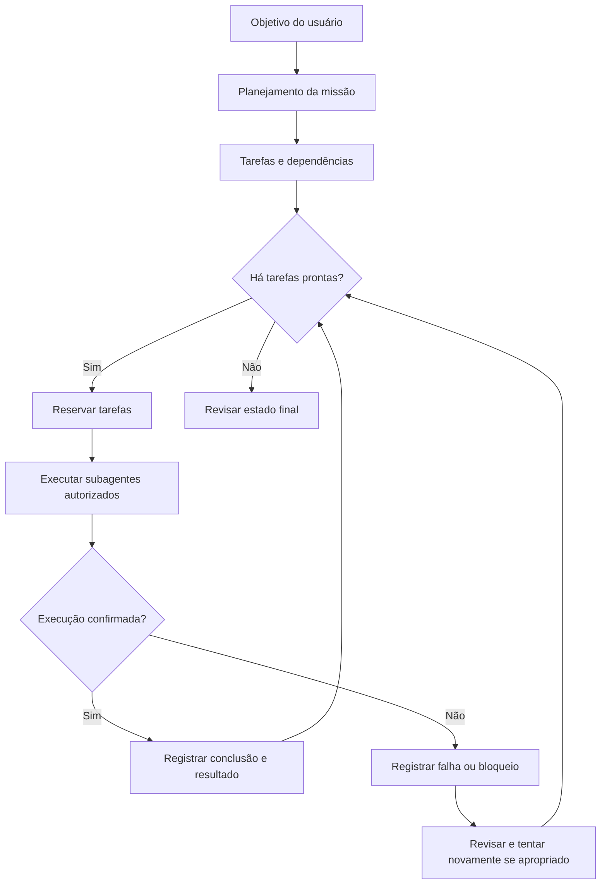
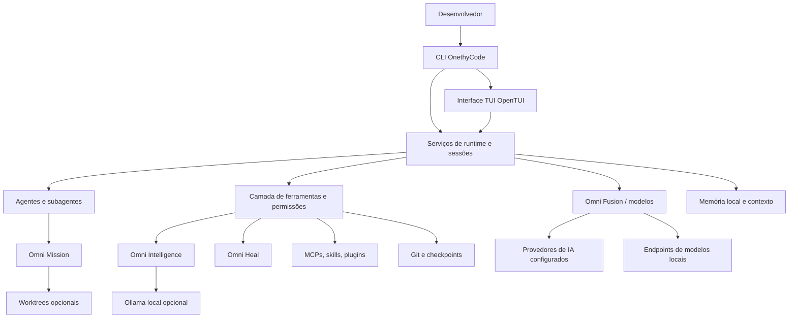
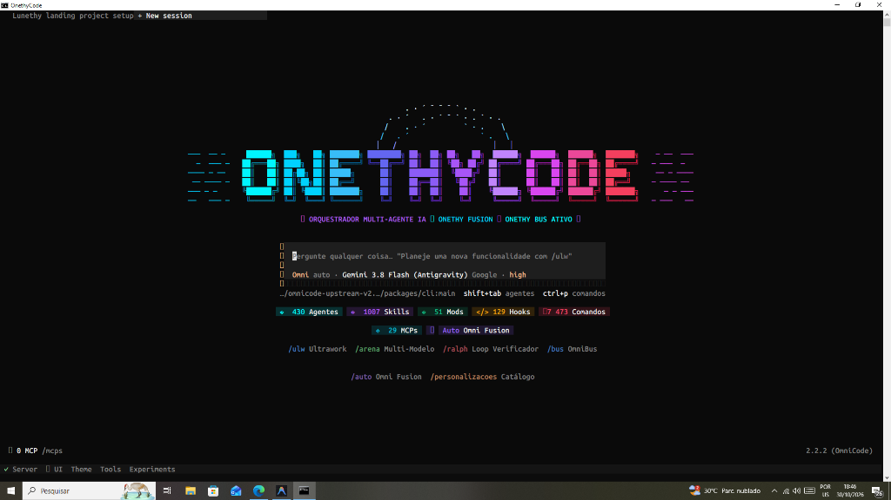

<div align="center">

# ⚡ OnethyCode

### Ambiente de desenvolvimento com inteligência artificial, agentes especializados e múltiplos modelos — direto no terminal.

**Planeje. Programe. Pesquise. Revise. Teste. Mantenha o contexto.**

Uma plataforma open source, baseada no [OpenCode](https://github.com/anomalyco/opencode), que reúne interface interativa no terminal, roteamento entre modelos, ferramentas MCP, coordenação de agentes e memória local para apoiar o desenvolvimento de software.

[](https://github.com/danie2022157-ui/onethy-code/stargazers)
[](LICENSE)
[](https://www.typescriptlang.org/)
[](https://bun.sh/)
[](#interface-e-comandos)



**Um ambiente de programação assistida por IA que coloca o desenvolvedor no controle do fluxo de trabalho.**

[Começar](#instalação-e-primeiros-passos) · [Funcionalidades](#funcionalidades-em-detalhes) · [Multiagentes](#agentes-e-orquestração-de-missões) · [Arquitetura](#arquitetura-do-sistema) · [Comandos](#interface-e-comandos) · [Perguntas frequentes](#perguntas-frequentes) · [English](#english-overview)

</div>

---

## Sumário

1. [O que é o OnethyCode](#o-que-é-o-onethycode)
2. [Por que ele existe](#por-que-ele-existe)
3. [Visão geral das capacidades](#visão-geral-das-capacidades)
4. [Funcionalidades em detalhes](#funcionalidades-em-detalhes)
5. [Agentes e orquestração de missões](#agentes-e-orquestração-de-missões)
6. [Memória e continuidade](#memória-e-continuidade)
7. [Inteligência e pesquisa de código](#inteligência-e-pesquisa-de-código)
8. [Instalação e primeiros passos](#instalação-e-primeiros-passos)
9. [Interface e comandos](#interface-e-comandos)
10. [Fluxos de uso](#fluxos-de-uso)
11. [Arquitetura do sistema](#arquitetura-do-sistema)
12. [Estrutura do repositório](#estrutura-do-repositório)
13. [Segurança, privacidade e controle](#segurança-privacidade-e-controle)
14. [Qualidade e testes](#qualidade-e-testes)
15. [Limitações atuais e evolução](#limitações-atuais-e-evolução)
16. [Perguntas frequentes](#perguntas-frequentes)
17. [Contribuição e licença](#contribuição-e-licença)
18. [English overview](#english-overview)

## O que é o OnethyCode?

**OnethyCode é um ambiente de desenvolvimento assistido por inteligência artificial, com foco no terminal.** Seu objetivo é reunir, em uma única experiência, a interação com modelos de linguagem, o entendimento de repositórios, a organização de tarefas, o uso de ferramentas locais e a colaboração entre agentes especializados.

Em vez de tratar a IA apenas como um chat que responde perguntas, o projeto organiza um fluxo de engenharia de software: entender o problema, localizar código relevante, propor uma solução, executar ações autorizadas, verificar resultados, documentar decisões e retomar o trabalho em outras sessões.

Ele combina uma **CLI** (interface de linha de comando), uma **TUI** (interface visual dentro do terminal), serviços de execução, integração com provedores de IA e mecanismos de persistência local. A base técnica deriva do OpenCode e recebe módulos específicos do OnethyCode, como **Omni Fusion**, **Omni Mission**, **Memory Bank**, **Omni Intelligence** e **Omni Heal**.

> **Importante:** OnethyCode é software em evolução. A existência de um módulo no repositório não garante que todas as combinações de provedores, sistemas operacionais e integrações tenham sido verificadas em produção. O projeto prioriza a execução com permissões, registros verificáveis e revisão humana.

## Por que ele existe?

Trabalhar com várias ferramentas de IA para programação normalmente envolve desafios como trocar de modelo manualmente, repetir informações importantes, perder o histórico de decisões entre sessões, descobrir onde uma funcionalidade está implementada, coordenar tarefas longas e conferir se mudanças realmente passaram nos testes.

O OnethyCode procura reduzir essa fragmentação com uma experiência orientada a projetos. Seus princípios são:

- **Terminal como ambiente principal:** iniciar o assistente no diretório em que o trabalho acontece, sem exigir uma extensão de IDE.
- **Liberdade de modelos:** escolher entre provedores e modelos configurados em vez de depender de um único fornecedor.
- **Contexto reutilizável:** manter notas sobre arquitetura, convenções e objetivos, separando memórias do projeto e preferências globais.
- **Agentes com papéis claros:** distribuir trabalho entre agentes especializados quando isso for útil e permitido.
- **Resultados verificáveis:** diferenciar tarefas planejadas, reservadas, executadas e efetivamente concluídas.
- **Segurança operacional:** respeitar permissões de ferramentas, confirmar mudanças destrutivas e preservar dados de outros projetos.
- **Código aberto:** permitir inspeção, contribuição e evolução da plataforma.

## Visão geral das capacidades

| Área | Funcionalidade | Situação / dependências |
| :--- | :--- | :--- |
| **CLI e TUI** | Terminal interativo, comandos, seleção de agentes, sessões e integrações | Implementado; compatibilidade visual varia conforme o terminal |
| **Omni Fusion** | Seleção, filtros e regras de roteamento de modelos | Depende dos modelos e provedores configurados |
| **Agentes especializados** | Perfis como planejador, arquiteto, programador e revisor | Disponíveis conforme contexto, permissões e configuração |
| **Omni Mission** | Missões com tarefas, dependências, status e dispatch paralelo limitado | A execução acontece durante a chamada da ferramenta; não é um serviço autônomo permanente |
| **Subagentes e worktrees** | Sessões-filhas e isolamento opcional do trabalho com Git worktrees | Requer Git, ferramentas e permissões adequadas |
| **Memory Bank** | Memória por projeto e preferências globais locais | Persistência local; sem sincronização automática entre computadores |
| **Omni Intelligence** | Busca lexical, histórico do projeto, revisão Git, inventário de ferramentas e métricas | Funções limitadas ao projeto/sessões acessíveis |
| **Busca semântica** | Embeddings locais via Ollama | Opcional; requer Ollama e `nomic-embed-text` instalados |
| **Omni Heal** | Execução de verificações, diagnóstico e tentativas autorizadas de reparo | Tentativas limitadas; resultado não é garantido |
| **MCP e extensões** | Configuração de servidores MCP, skills, plugins, hooks e comandos | Conexão e execução dependem de cada integração |
| **Gestor de projetos** | Criar, registrar, abrir, renomear e ocultar projetos da lista | Remover da lista não apaga arquivos |
| **Git e checkpoints** | Inspeção de mudanças, snapshots de arquivos rastreados e restauração confirmada | Não substitui backup completo |
| **Atualização** | Verificação e atualização de checkouts compatíveis | Depende da instalação e do repositório oficial |
| **Desinstalação Windows** | Script PowerShell independente com prévia de caminhos | Requer revisão dos caminhos; teste antes de confiar em ambiente real |

## Funcionalidades em detalhes

### 1. Omni Fusion — roteamento de modelos

O **Omni Fusion** é a camada de seleção de modelos do OnethyCode. Ele permite trabalhar com os modelos disponíveis nas contas e integrações que o usuário configurou, aplicando políticas e preferências de seleção.

Entre os controles presentes no projeto estão a visualização de provedores conectados, o filtro de modelos permitidos, categorias de capacidade, ajustes de roteamento e mecanismos de fallback/cooldown.

**O que isso oferece na prática:**

- Consultar modelos disponibilizados pelos provedores conectados.
- Escolher modelos explicitamente ou usar as opções automáticas.
- Restringir a seleção a modelos ou provedores autorizados.
- Alternar estratégias conforme o tipo de tarefa e as preferências configuradas.
- Examinar opções de modelos pela interface `/models` e pelo seletor `/fusion-models`.

O roteamento não garante que um modelo esteja disponível, gratuito ou sem limites de uso. Cotas, autenticação, custos e capacidades são definidos pelos respectivos provedores. O sistema também não possui acesso universal às cotas de todos os fornecedores.

### 2. Agentes especializados

O projeto disponibiliza papéis e fluxos para diferentes atividades de engenharia de software. Isso ajuda a separar as responsabilidades de quem planeja, implementa, analisa ou revisa um trabalho.

| Papel | Responsabilidade típica |
| :--- | :--- |
| **Planner / Plan** | Organizar requisitos, dependências e etapas de implementação |
| **Architect** | Examinar arquitetura, interfaces e decisões técnicas |
| **Coder** | Implementar ou modificar código quando autorizado |
| **Reviewer** | Revisar alterações, riscos e consistência |
| **Librarian** | Auxiliar na recuperação e organização do contexto |
| **Orchestrator / Omni** | Coordenar a estratégia e a distribuição das tarefas |

Esses papéis não dispensam validação. Um resultado produzido por um agente continua sujeito a testes, revisão e permissões do ambiente.

### 3. Integrações MCP e ferramentas extensíveis

**MCP (Model Context Protocol)** permite conectar modelos e agentes a ferramentas e fontes adicionais por meio de servidores compatíveis.

O repositório contém implementações relacionadas a clientes MCP, transporte por processos locais e sockets, OAuth, configuração, catálogo e diagnóstico. Na CLI existem comandos como:

```bash
onethy mcp list
onethy mcp doctor
onethy mcp add
onethy mcp auth
```

A disponibilidade exata dos subcomandos e das opções deve ser confirmada com `onethy mcp --help` na versão instalada.

Além de MCPs, o projeto contempla **skills**, **plugins**, **hooks**, **comandos personalizados** e definições de agentes. Descobrir uma ferramenta não significa que ela está conectada nem que um agente tem autorização para executá-la.

### 4. Gestão de projetos e sessões

O gerenciador de projetos do OnethyCode ajuda a trabalhar com múltiplos repositórios em um mesmo ambiente. A interface `/projects` permite criar um diretório de projeto, registrar uma pasta existente, abrir um projeto e alterar seu nome de exibição.

A remoção de um projeto da lista significa **ocultá-lo do gerenciador**, não deletar seu código ou seu histórico. Esse comportamento é proposital para reduzir o risco de exclusões acidentais.

Também existem recursos de sessões, retomada de contexto, gerenciamento de mensagens e operações pela CLI, como `onethy session list`.

### 5. Revisão, checkpoints e segurança com Git

Os recursos de Git são importantes para auditar o trabalho dos agentes antes de aceitar mudanças. O projeto inclui ferramentas de revisão e checkpoints de arquivos rastreados.

A ferramenta `omni_checkpoint` oferece operações de criação, listagem, comparação e restauração. A restauração é condicionada a verificações de segurança, incluindo confirmação explícita, estado limpo do repositório e compatibilidade com o HEAD original.

**Limitação essencial:** checkpoints não incluem todos os arquivos não rastreados e não substituem backup, branch de trabalho ou controle de versão tradicional.

## Agentes e orquestração de missões

A ferramenta **`omni_mission`** representa tarefas como um grafo de dependências. Ela ajuda os agentes a saber o que está pronto para começar, o que está bloqueado e quais resultados foram registrados.

### Ciclo de vida de uma missão



### Operações disponíveis

| Ação | Resultado esperado |
| :--- | :--- |
| `create` | Cria a missão, define o objetivo e valida dependências |
| `status` | Consulta as tarefas e seus estados |
| `claim` | Reserva tarefas prontas, sem marcá-las como concluídas |
| `dispatch` | Invoca subagentes para tarefas disponíveis |
| `complete` | Registra uma conclusão com resultado fornecido |
| `fail` | Registra uma falha ou bloqueio |
| `retry` | Permite nova tentativa de tarefa elegível |

O código aceita **1 a 8 tarefas em paralelo**, com **3 como padrão** em `maxParallel`. O dispatch é limitado e executado na sessão atual; não representa centenas de agentes rodando permanentemente sem supervisão.

Quando configurado, o sistema pode utilizar Git worktrees para isolar agentes de programação. Isso ajuda a reduzir colisões entre tarefas, mas aumenta o uso de disco e exige uma etapa consciente de revisão e integração de alterações.

**Exemplo de solicitação:**

```text
Analise o módulo de autenticação, divida a refatoração em tarefas,
identifique dependências e proponha uma missão com planejamento,
implementação, testes e revisão. Não altere arquivos antes de
apresentar o plano.
```

Para detalhes da implementação, consulte [`omni-mission.ts`](packages/core/src/tool/plugin/omni-mission.ts), [`omni-orchestrator.ts`](packages/core/src/omni-orchestrator.ts) e [`subagent.ts`](packages/core/src/tool/plugin/subagent.ts).

## Memória e continuidade

Uma sessão de IA pode perder informações importantes quando a conversa cresce ou é encerrada. O **Memory Bank** foi desenvolvido para preservar informações escolhidas sobre o projeto sem exigir que o usuário repita toda a explicação a cada interação.

### Memória específica do projeto

A memória do projeto fica em:

```text
<projeto>/
└── .omnicode/
    └── memory-bank/
        ├── project-brief.md
        ├── system-patterns.md
        ├── tech-context.md
        └── active-context.md
```

Esses documentos podem guardar:

- Objetivos e contexto do produto.
- Decisões de arquitetura e convenções de código.
- Tecnologias, integrações e limitações relevantes.
- Prioridades atuais, pendências e próximos passos.

### Memória global local

Há também memória global do mesmo usuário e da mesma instalação, dentro do diretório de configuração do OnethyCode:

```text
<configuração-do-onethycode>/
└── memory-bank/
    ├── preferences.md
    ├── rules.md
    └── knowledge.md
```

Ela foi pensada para preferências e conhecimentos reutilizáveis entre diferentes projetos, sem misturar os dados específicos de cada cliente.

### Ferramenta omni_memory

A ferramenta `omni_memory` oferece ações como `init`, `status`, `read`, `update`, `delete` e `clear`, com escolha de escopo `project` ou `global`.

```json
{
  "action": "update",
  "scope": "global",
  "file": "preferences",
  "content": "Prefiro respostas técnicas em português e testes antes de concluir tarefas.",
  "append": true
}
```

**Importante:** o projeto não afirma capturar automaticamente todas as conversas nem sincronizar memórias entre dispositivos. Alterações de memória devem ser intencionais, e memórias globais não devem conter tokens, senhas ou informações confidenciais de clientes. Exclusões globais exigem confirmação explícita.

Leia a [documentação da memória global](docs/onethy-global-memory.md).

## Inteligência e pesquisa de código

A ferramenta **`omni_intelligence`** reúne ações para localizar informações relevantes e apoiar decisões técnicas.

| Ação | O que faz | Dependência ou limite |
| :--- | :--- | :--- |
| `code` | Busca lexical por funções, símbolos e termos relacionados à intenção | Funciona localmente, com limites de arquivos e tamanho |
| `semantic` | Busca vetorial por significado usando embeddings | Ollama local + `nomic-embed-text` |
| `tools` | Inventaria ferramentas, skills e MCPs disponíveis | Não concede permissões |
| `history` | Pesquisa sessões e notas dentro do projeto acessível | Não pesquisa automaticamente toda a conta |
| `review` | Mostra mudanças Git staged e unstaged sem editá-las | Revisão somente de leitura |
| `metrics` | Resume eventos e consumo registrado em sessões | Não é ferramenta de faturamento exato |

### Busca lexical

Útil quando se sabe aproximadamente o nome, a função ou o comportamento a encontrar:

```text
Use omni_intelligence action=code para localizar a função
responsável pela validação da sessão do usuário.
```

### Busca semântica local com Ollama

A busca semântica permite procurar por descrição do comportamento em vez de apenas palavras exatas do código.

```text
Use omni_intelligence action=semantic para encontrar
onde são aplicadas as regras de autenticação e autorização.
```

O mecanismo utiliza o servidor Ollama local em `http://127.0.0.1:11434` com o modelo `nomic-embed-text`. O usuário precisa preparar esse ambiente. O código da busca semântica possui limites de indexação, filtra diretórios gerados e evita arquivos com padrões de nomes sensíveis.

Essa função não deve ser anunciada como indexação ilimitada e permanente de qualquer repositório. Consulte [a documentação de inteligência no terminal](docs/onethy-terminal-intelligence.md).

### Diagnóstico e tentativa de correção com Omni Heal

**`omni_heal`** pode executar verificações, coletar saídas de erro e retornar orientações de diagnóstico. Com `autoFix=true`, pode tentar delegar um reparo a um subagente `coder` e executar novas verificações.

```text
Execute os testes do módulo, explique cada falha
e proponha a correção. Peça aprovação antes de alterar
arquivos importantes.
```

O número de tentativas é limitado (padrão 3 quando a correção automática está habilitada; máximo configurável 5). Essas ações exigem permissões para executar comandos e, quando aplicável, invocar subagentes. Uma tentativa concluída não equivale automaticamente a um sistema corrigido: verifique os testes e o comportamento funcional.

## Instalação e primeiros passos

### Pré-requisitos

| Requisito | Finalidade |
| :--- | :--- |
| **Git** | Clonar o projeto e gerenciar mudanças |
| **Node.js 20+** | Executar o inicializador do OnethyCode |
| **Bun** | Gerenciar dependências e executar o workspace; o repositório fixa `bun@1.4.4` |
| **Terminal compatível** | Executar a TUI, com comportamento gráfico variável conforme o host |
| **Provedor de IA ou modelo local** | Usar funcionalidades que necessitam de modelos |
| **Ollama, opcional** | Habilitar buscas vetoriais locais |

A instalação atual é feita a partir do **código-fonte**. Não se trata de um instalador totalmente independente que embute todos os recursos do projeto.

### Windows — PowerShell

```powershell
git clone https://github.com/danie2022157-ui/onethy-code.git
cd onethy-code
bun install --frozen-lockfile
.\install.ps1
onethy
```

O instalador registra os atalhos do OnethyCode no ambiente do usuário. **Não apague a pasta clonada após instalar**: o comando instalado usa os arquivos existentes nesse checkout.

Recomenda-se utilizar uma janela de terminal atualizada e revisar eventuais avisos de compatibilidade da TUI. Se houver problemas na inicialização, obtenha a saída de `onethy --help` e os detalhes do terminal antes de modificar configurações.

### Linux e macOS

```bash
git clone https://github.com/danie2022157-ui/onethy-code.git
cd onethy-code
bun install --frozen-lockfile
bash ./install.sh
onethy
```

O instalador cria atalhos em `~/.local/bin`; verifique se esse diretório está incluído na variável `PATH`.

### Primeiro acesso

Depois de iniciar `onethy`:

1. Abra `/help` para conhecer os comandos realmente disponíveis na sua versão.
2. Use `/connect` para conectar um provedor de IA.
3. Abra `/models` e `/fusion-models` para conferir os modelos utilizáveis.
4. Entre na pasta do projeto em que deseja trabalhar.
5. Use uma solicitação pequena e verificável antes de automatizar alterações complexas.

### Atualização

Em um checkout compatível:

```bash
git pull --ff-only origin main
bun install --frozen-lockfile
```

O projeto também inclui uma interface `/update` para fluxos suportados. Faça backup de alterações locais antes de atualizar. O controle de atualizações não implica instalação automática e não substitui a revisão das mudanças.

## Interface e comandos

A interface de terminal oferece comandos interativos. Esta tabela documenta os comandos registrados no código da TUI consultado; funcionalidades adicionais podem existir em plugins ou configurações do serviço.

| Comando da TUI | Finalidade |
| :--- | :--- |
| `/help` | Ajuda e atalhos da instalação atual |
| `/connect` | Configurar conexões com provedores |
| `/models` | Selecionar ou visualizar modelos |
| `/auto` | Configurar fluxo de roteamento automático / Omni Fusion |
| `/fusion-models` | Filtrar modelos permitidos no Omni Fusion |
| `/tier`, `/thinking`, `/variants` | Ajustar estratégias, níveis e variantes disponíveis |
| `/agents` | Explorar agentes |
| `/orchestrator` (alias `/omni`) | Acessar a função de orquestração |
| `/plan`, `/architect`, `/coder`, `/reviewer`, `/librarian` | Escolher papéis especializados |
| `/projects` (alias `/projetos`) | Abrir o gestor de projetos |
| `/sessions` | Consultar e retomar sessões |
| `/memory` | Consultar o Memory Bank do projeto |
| `/mcps` | Inspecionar o estado dos MCPs |
| `/skills`, `/hooks`, `/plugins` | Explorar personalizações e extensões |
| `/customizations` (alias `/personalizacoes`) | Catálogo de personalizações |
| `/settings` | Ajustar preferências da interface |
| `/usage`, `/status` | Informações de uso e estado |
| `/update` | Verificar e aplicar atualização compatível |
| `/worktrees` | Acessar recursos de worktree quando disponibilizados |
| `/exit` | Sair da interface |

Comandos adicionais como `/memory-global`, `/heal`, `/checkpoint`, `/undo`, `/team` e `/mission` podem ser disponibilizados por comandos configurados no serviço. Use `/help` para confirmar sua presença e consulte as ferramentas correspondentes quando um comando não estiver registrado na interface.

### Comandos da CLI

A CLI também possui subcomandos que não dependem de uma sessão gráfica aberta:

```bash
onethy --help
onethy models
onethy auth list
onethy mcp list
onethy mcp doctor
onethy plugin list
onethy session list
onethy debug paths
onethy service status
```

Outros grupos incluem `run`, `mini`, `serve`, `stats`, `pair`, `upgrade` e `uninstall`. Para opções e parâmetros, consulte sempre `onethy <subcomando> --help`.

## Fluxos de uso

### Cenário A — Entender um projeto desconhecido

**Objetivo:** identificar estrutura, tecnologias e pontos relevantes sem modificar arquivos.

```text
Analise este repositório. Identifique as pastas mais importantes,
as dependências principais, o fluxo de inicialização e os
componentes envolvidos na autenticação. Não altere nenhum arquivo.
```

O agente pode usar ferramentas de leitura, busca e histórico para construir uma explicação com base nos arquivos acessíveis.

### Cenário B — Implementar uma funcionalidade com planejamento

**Objetivo:** adicionar uma funcionalidade com etapas e verificações explícitas.

```text
Quero adicionar autenticação por sessão a esta API.
Primeiro descreva a arquitetura atual e proponha um plano.
Depois de aprovado, implemente em etapas, crie testes
e apresente um resumo das alterações.
```

O usuário pode escolher um agente de planejamento, organizar dependências com `omni_mission` e solicitar execução mediante as permissões necessárias.

### Cenário C — Trabalhar com agentes paralelos

**Objetivo:** distribuir tarefas independentes, evitando que todo trabalho fique com um único agente.

```text
Separe esta refatoração em tarefas de backend, testes e revisão.
Use dependências explícitas e apenas execute tarefas paralelas
quando não houver conflito de arquivos. Mostre os resultados
e bloqueios de cada agente.
```

O dispatch permite paralelismo limitado. Para mudanças de código, o isolamento com worktrees pode ser útil, mas a integração final permanece uma etapa de engenharia que precisa de revisão.

### Cenário D — Diagnosticar erros

**Objetivo:** entender por que uma alteração não passou nas verificações.

```text
Execute os testes relevantes, classifique as falhas por causa
provável e proponha a menor correção segura. Não declare
o problema resolvido antes de repetir os testes.
```

O `omni_heal` pode ajudar nesse processo, mas não promete reparo bem-sucedido de todos os erros.

### Cenário E — Recuperar contexto de uma decisão

**Objetivo:** retomar trabalho após outra sessão.

```text
Consulte a memória deste projeto e as notas de arquitetura.
Resuma as decisões técnicas registradas, tarefas pendentes
e os arquivos que preciso revisar antes de continuar.
```

A qualidade da recuperação depende dos registros que foram efetivamente preservados e dos dados acessíveis à instalação.

## Arquitetura do sistema

A arquitetura combina interface, serviços do projeto, ferramentas e integrações externas, com diferentes níveis de controle e persistência.



### Componentes principais

| Componente | Responsabilidade |
| :--- | :--- |
| **CLI** | Entrada de comandos, execução não interativa e operações de configuração |
| **TUI** | Interface interativa, navegação, seleção de modelos e agentes |
| **Core** | Ferramentas, orquestração, sessões, modelos, permissões e serviços |
| **Omni Fusion** | Estratégias de escolha e filtragem de modelos |
| **Omni Mission** | Estado persistente das tarefas, dependências e dispatch |
| **Memory Bank** | Armazenamento de contexto local de projeto e usuário |
| **MCP** | Comunicação com ferramentas e recursos compatíveis |
| **Git/Worktree** | Inspeção, isolamento opcional e verificação de alterações |

**Stack do repositório:** TypeScript, Bun, Node.js, OpenTUI, Solid e bibliotecas do ecossistema OpenCode. É um monorepo com pacotes compartilhados, serviços e testes de integração.

## Estrutura do repositório

Abaixo está um mapa das áreas mais relevantes para quem deseja estudar ou contribuir:

```text
onethy-code/
├── bin/                             # Inicializadores e resolução do runtime
├── packages/
│   ├── cli/                         # CLI, comandos e integração com o terminal
│   ├── tui/                         # Interface interativa OpenTUI
│   ├── core/                        # Agentes, ferramentas, sessões e orquestração
│   ├── util/                        # Utilitários e isolamento de configuração
│   └── ...                          # Outros pacotes do workspace OpenCode
├── docs/
│   ├── onethy-terminal-intelligence.md
│   ├── onethy-global-memory.md
│   └── ...                          # Documentação e planos técnicos
├── assets/                          # Imagens e materiais do repositório
├── .github/workflows/               # CI e testes automatizados
├── install.ps1                      # Instalação no Windows
├── install.sh                       # Instalação Linux/macOS
├── uninstall.ps1                    # Desinstalador Windows com prévia
├── package.json                     # Workspace e scripts
├── bun.lock                         # Dependências fixadas
├── CONTRIBUTING.md
├── SECURITY.md
└── LICENSE
```

### Arquivos relevantes para estudar as funcionalidades

- [Omni Orchestrator](packages/core/src/omni-orchestrator.ts)
- [Ferramenta Omni Mission](packages/core/src/tool/plugin/omni-mission.ts)
- [Ferramenta Omni Intelligence](packages/core/src/tool/plugin/omni-intelligence.ts)
- [Busca semântica local](packages/core/src/omni-embeddings.ts)
- [Ferramenta Omni Heal](packages/core/src/tool/plugin/omni-heal.ts)
- [Ferramenta Omni Memory](packages/core/src/tool/plugin/omni-memory.ts)
- [Ferramenta de Checkpoints](packages/core/src/tool/plugin/omni-checkpoint.ts)
- [Configuração MCP](packages/core/src/config/plugin/mcp.ts)
- [Gerenciador de projetos da TUI](packages/tui/src/component/dialog-projects.tsx)
- [Comandos da CLI](packages/cli/src/commands/commands.ts)
- [Registro de comandos da TUI](packages/tui/src/app.tsx)

## Segurança, privacidade e controle

O projeto trabalha com ferramentas capazes de inspecionar arquivos, executar comandos, interagir com serviços e modificar código. Por isso, o uso seguro exige limites claros.

### Princípios operacionais

1. **Permissões:** a disponibilidade de uma ferramenta não implica autorização automática para executar ações.
2. **Confirmações:** operações destrutivas ou de restauração devem ser inspecionadas e confirmadas.
3. **Limites de execução:** tarefas, buscas e tentativas de reparo têm limites definidos no código.
4. **Revisão de resultados:** alterações feitas por agentes devem passar por inspeção e testes.
5. **Separação de dados:** o ambiente OnethyCode utiliza diretórios locais próprios para configuração e dados, separados de uma instalação comum do OpenCode.
6. **Gestão de credenciais:** tokens e senhas devem permanecer fora do controle de versão e fora do Memory Bank.

### Onde os dados ficam?

No Windows, os diretórios padrão do OnethyCode utilizam a nomenclatura interna `omnicode`, sob `%APPDATA%` e `%LOCALAPPDATA%`. Em Linux/macOS, utilizam diretórios XDG do usuário. O caminho efetivo pode variar com a configuração.

Para descobrir os caminhos da instalação atual:

```bash
onethy debug paths
onethy debug paths config
onethy debug paths data
```

A memória global é **local à instalação**. Não há promessa de sincronização automática com GitHub, com outros dispositivos ou com contas externas.

### Desinstalação no Windows

O repositório inclui `uninstall.ps1`, um desinstalador PowerShell que pode funcionar independentemente da TUI. Antes de qualquer exclusão, é possível visualizar os caminhos propostos:

```powershell
.\uninstall.ps1 -Checkout (Get-Location).Path -Preview
```

**Cuidado:** a operação de desinstalação completa foi projetada para remover a pasta do checkout, os arquivos de configuração e dados locais do OnethyCode e atalhos reconhecidos da instalação. Isso pode incluir modificações locais ainda não enviadas ao GitHub. Leia a prévia, verifique o relatório final e guarde cópias de segurança quando necessário.

A presença de um script ou comando `/unistall` não é garantia de sucesso em qualquer ambiente: falhas e itens preservados precisam ser examinados. A ferramenta não deve excluir outros projetos nem o repositório remoto no GitHub.

## Qualidade e testes

O código contém testes unitários e de regressão para componentes de orquestração, memória, seleção de modelos, ferramentas, segurança de checkpoints, MCPs, CLI e TUI. O repositório também utiliza workflows do GitHub Actions com verificações em diferentes sistemas operacionais.

### Testes focados

Execute os comandos na raiz do repositório, após instalar as dependências:

```bash
bun --cwd packages/core test test/omni-model-selection.test.ts
bun --cwd packages/core test test/omni-orchestrator.test.ts test/omni-mission-control.test.ts
bun --cwd packages/core test test/omni-memory-bank.test.ts
bun --cwd packages/core test test/omni-intelligence.test.ts test/omni-embeddings.test.ts
bun --cwd packages/core test test/omni-checkpoint-safety.test.ts
bun --cwd packages/cli test test/mcp-config-path.test.ts test/uninstall-purge.test.ts
bun --cwd packages/tui test test/uninstall-command.test.ts
```

### Verificações de tipos

```bash
bun --cwd packages/core run typecheck:tsc
bun --cwd packages/cli run typecheck:tsc
bun --cwd packages/tui run typecheck:tsc
```

Testes automatizados ajudam a verificar comportamento e prevenir regressões, mas **não substituem** testes de ponta a ponta com provedores reais, autenticação, terminais específicos e permissões do usuário. Uma alteração publicada na `main` pode exigir verificações adicionais antes de ser considerada adequada à produção.

## Limitações atuais e evolução

É importante distinguir funcionalidades já presentes no código de recursos que exigem configuração ou ainda fazem parte da direção de evolução do produto.

| Tema | Estado responsável |
| :--- | :--- |
| **Compatibilidade Windows** | A instalação por código-fonte existe; alguns hosts de terminal podem apresentar diferenças na renderização |
| **Provedores e modelos** | As integrações dependem de autenticação e suporte do provedor; não há garantia de disponibilidade universal |
| **Agentes em paralelo** | Há dispatch limitado; não existe uma malha de centenas de agentes permanentemente ativa por padrão |
| **Memória** | Persistência local por projeto/instalação; sem sincronização automática multi-dispositivo |
| **Autocorreção** | Diagnóstico e tentativas limitadas; não garante que um problema seja corrigido |
| **Busca semântica** | Exige Ollama local e modelo de embeddings instalado |
| **Web e aplicativos externos** | Dependem das ferramentas conectadas e de permissões; não equivalem a controle irrestrito do computador |
| **Atualizações e distribuição** | O fluxo principal utiliza checkout de origem; um canal de instalação independente requer trabalho adicional |
| **Implantação em produção** | Exige avaliação de segurança, estabilidade e compatibilidade no ambiente de destino |

### Áreas de melhoria

O desenvolvimento futuro pode concentrar esforços em:

- Ampliar testes de integração com provedores de IA e MCPs reais.
- Aprimorar a robustez da TUI em diferentes consoles Windows.
- Tornar o fluxo de instalação, atualização e desinstalação mais previsível.
- Melhorar observabilidade, relatórios de agentes e recuperação após falhas.
- Expandir os recursos de busca e indexação respeitando privacidade e limites de hardware.
- Evoluir os mecanismos de execução concorrente sem comprometer revisão, isolamento e segurança.
- Refinar onboarding, documentação e exemplos reproduzíveis.

Esses pontos representam **oportunidades de evolução**, não uma promessa de entrega ou um cronograma oficial.

## Perguntas frequentes

<details>
<summary><strong>O OnethyCode é uma extensão do VS Code?</strong></summary>

Não. O foco atual é a execução no terminal. Ele usa uma interface TUI própria e também oferece operações por CLI. O projeto é baseado no código do OpenCode.

</details>

<details>
<summary><strong>Preciso de várias assinaturas de IA para usar?</strong></summary>

Não necessariamente. Você precisa configurar ao menos uma fonte de modelos compatível com seu uso. A escolha de provedores, custos e modelos depende de suas credenciais e dos serviços disponíveis. O OnethyCode não fornece acesso gratuito ilimitado a serviços externos.

</details>

<details>
<summary><strong>É possível usar modelos locais?</strong></summary>

O ecossistema de configuração pode trabalhar com endpoints locais compatíveis, dependendo da integração. A busca semântica do Omni Intelligence usa especificamente o Ollama local com `nomic-embed-text` e requer configuração prévia. Execução inteiramente offline de todas as funções não é garantida.

</details>

<details>
<summary><strong>Ele pode modificar meu código automaticamente?</strong></summary>

Os agentes podem usar ferramentas de edição e execução quando essas ações estão disponíveis e autorizadas. O resultado precisa ser revisado e testado, principalmente em alterações extensas ou sensíveis.

</details>

<details>
<summary><strong>Os agentes realmente trabalham em paralelo?</strong></summary>

O `omni_mission` implementa dispatch limitado de subagentes e controle de dependências. Isso não significa execução contínua e ilimitada em segundo plano. A ferramenta registra o estado e precisa receber evidência de execução para marcar tarefas como concluídas.

</details>

<details>
<summary><strong>Posso executar centenas de agentes simultaneamente?</strong></summary>

Essa não é uma capacidade garantida da implementação atual. O dispatch do `omni_mission` valida `maxParallel` entre 1 e 8. Paralelismo maior exigiria arquitetura, recursos e validação adicionais.

</details>

<details>
<summary><strong>A memória guarda automaticamente todas as conversas?</strong></summary>

Não. O Memory Bank trabalha com arquivos locais e atualizações deliberadas. O histórico consultável também possui limites. A memória global não sincroniza automaticamente com outros computadores.

</details>

<details>
<summary><strong>A busca semântica envia meu repositório para uma nuvem?</strong></summary>

A implementação local de embeddings do `omni_intelligence` usa Ollama em `127.0.0.1` e não depende de um servidor remoto para essa operação. Outras ferramentas e provedores configurados podem possuir políticas próprias de envio de dados.

</details>

<details>
<summary><strong>O comando de autocorreção resolve qualquer bug?</strong></summary>

Não. `omni_heal` executa diagnóstico e, se autorizado, pode tentar corrigir e verificar erros em ciclos limitados. Resultados dependem do projeto, das permissões e da qualidade dos testes existentes.

</details>

<details>
<summary><strong>Como faço para atualizar o OnethyCode?</strong></summary>

No checkout oficial, use `git pull --ff-only origin main` e `bun install --frozen-lockfile`. Também existe `/update` para instalações compatíveis. Faça backup de alterações locais antes de aplicar atualizações.

</details>

<details>
<summary><strong>Excluir um projeto do gerenciador apaga os arquivos?</strong></summary>

Não. O gerenciador remove ou oculta a entrada da lista; não apaga o diretório do projeto.

</details>

<details>
<summary><strong>O projeto é gratuito e open source?</strong></summary>

O código deste repositório está publicado sob licença MIT. Os custos de serviços externos, modelos hospedados e infraestrutura não são cobertos automaticamente pela licença do software.

</details>

## Contribuição e licença

O OnethyCode recebe contribuições em documentação, testes, integração com ferramentas, experiência de terminal, estabilidade e arquitetura.

**Para contribuir:**

1. Leia [CONTRIBUTING.md](CONTRIBUTING.md) e [AGENTS.md](AGENTS.md).
2. Abra uma [issue](https://github.com/danie2022157-ui/onethy-code/issues) descrevendo o problema, necessidade ou proposta.
3. Trabalhe em uma branch separada, preferencialmente com mudanças pequenas e verificáveis.
4. Inclua testes para alterações de comportamento sempre que possível.
5. Envie um pull request explicando o resultado, limitações e forma de validação.

Para comunicar uma vulnerabilidade, siga [SECURITY.md](SECURITY.md). Para termos de uso e redistribuição, consulte [LICENSE](LICENSE).

## English overview

**OnethyCode is an open-source, terminal-first AI development workspace built on OpenCode.** It combines interactive CLI/TUI workflows, configurable model routing, specialized coding agents, persistent local project context, MCP integrations, Git-aware review tools, and bounded orchestration.

**Key capabilities:** Omni Fusion model selection; Omni Mission task dependencies and limited subagent dispatch; project and global Memory Bank; Omni Intelligence code/history search and optional local Ollama embeddings; Omni Heal diagnostics and permission-gated repair attempts; project management; skills, hooks, plugins and MCP servers.

**Core design principle:** keep developers in control. Tools require the appropriate permissions, agent results require verification, local memory is not automatic cloud sync, and automation is not unlimited or guaranteed to succeed.

**Getting started:** install Git, Node.js 20+ and the Bun version pinned by the repository; clone this repository; run `bun install --frozen-lockfile`; then use `install.ps1` on Windows or `install.sh` on Linux/macOS. Start with `onethy` and check `/help` for available commands.

See the sections above for architecture, commands, limitations, safety and testing.

---

<div align="center">



**⚡ OnethyCode — desenvolva com mais contexto, ferramentas e controle.**

Baseado no [OpenCode](https://github.com/anomalyco/opencode) · Licença [MIT](LICENSE) · [Repositório](https://github.com/danie2022157-ui/onethy-code) · [Issues](https://github.com/danie2022157-ui/onethy-code/issues)

</div>
