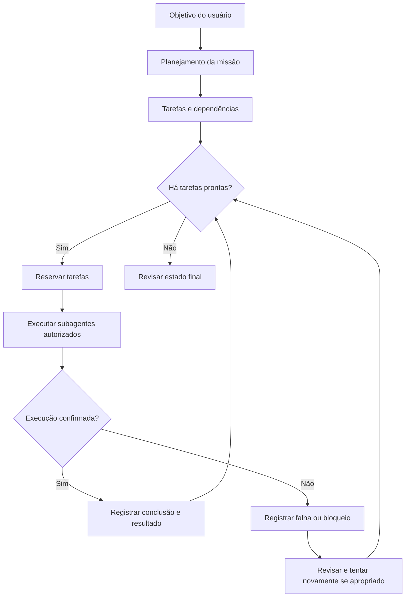
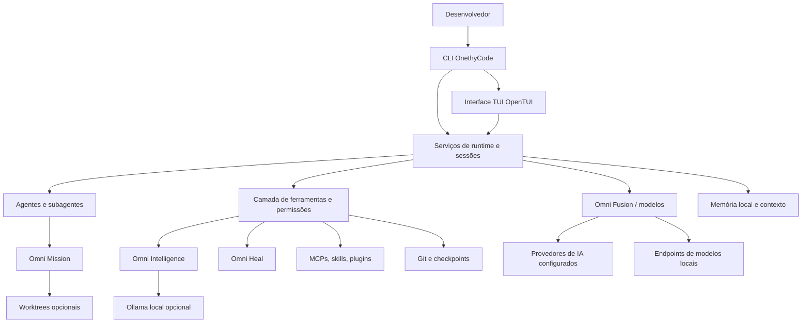

<div align="center">

# ⚡ OnethyCode

### Engenharia de software com IA — do planejamento ao código verificado.

**Seu workspace open source de desenvolvimento com IA, direto no terminal.**

Roteamento de modelos · Agentes especializados · MCPs · Pesquisa de código · Memória local · Revisão e testes

[](https://github.com/danie2022157-ui/onethy-code/actions/workflows/onethy-smoke.yml)
[](LICENSE)
[](https://www.typescriptlang.org/)
[](https://bun.sh/)
[](#interface-e-comandos)


**Planeje. Pesquise. Programe. Teste. Revise. Continue.**

[Começar](#instalação-e-primeiros-passos) · [Funcionalidades](#funcionalidades-em-detalhes) · [Agentes](#agentes-e-orquestração-de-missões) · [Arquitetura](#arquitetura-do-sistema) · [Comandos](#interface-e-comandos) · [English](#english-overview)

</div>

> [!NOTE]
> Baseado no [OpenCode](https://github.com/anomalyco/opencode), com módulos próprios do OnethyCode. Projeto em evolução: modelos e integrações exigem configuração, permissões e testes no ambiente real.

## Comece em minutos

Pré-requisitos: **Git, Node.js 20+, Bun (versão fixada no workspace)** e um provedor de IA compatível ou endpoint local configurado.

**Windows (PowerShell)**

```powershell
git clone https://github.com/danie2022157-ui/onethy-code.git
cd onethy-code
bun install --frozen-lockfile
.\install.ps1
onethy
```

**Linux / macOS**

```bash
git clone https://github.com/danie2022157-ui/onethy-code.git
cd onethy-code
bun install --frozen-lockfile
bash ./install.sh
onethy
```

Abra `/help`, conecte o provedor em `/connect` e consulte `/models`. A instalação usa o checkout local: **não exclua a pasta clonada depois de instalar**. Leia [requisitos e instruções completas](#instalação-e-primeiros-passos).

---

## Sumário

1. [Visão e propósito](#o-que-é-o-onethycode)
2. [Visão geral das capacidades](#visão-geral-das-capacidades)
3. [Funcionalidades em detalhes](#funcionalidades-em-detalhes)
4. [Agentes e orquestração de missões](#agentes-e-orquestração-de-missões)
5. [Memória e continuidade](#memória-e-continuidade)
6. [Inteligência e pesquisa de código](#inteligência-e-pesquisa-de-código)
7. [Instalação e primeiros passos](#instalação-e-primeiros-passos)
8. [Interface e comandos](#interface-e-comandos)
9. [Fluxos de uso](#fluxos-de-uso)
10. [Arquitetura do sistema](#arquitetura-do-sistema)
11. [Estrutura do repositório](#estrutura-do-repositório)
12. [Segurança, privacidade e controle](#segurança-privacidade-e-controle)
13. [Qualidade e testes](#qualidade-e-testes)
14. [Limitações atuais e evolução](#limitações-atuais-e-evolução)
15. [Diagnóstico e solução de problemas](#diagnóstico-e-solução-de-problemas)
16. [Perguntas frequentes](#perguntas-frequentes)
17. [Contribuição e licença](#contribuição-e-licença)
18. [English overview](#english-overview)

## O que é o OnethyCode?

O **OnethyCode** é um ambiente de engenharia de software com IA, focado em terminal, que integra **modelos configuráveis, agentes especializados, ferramentas locais, pesquisa contextual e fluxos de verificação**.

A ideia não é oferecer apenas um chat de programação, mas apoiar um ciclo completo: **entender o projeto → planejar → investigar → implementar → testar → revisar → retomar**. A infraestrutura deriva do OpenCode e recebe módulos específicos:

| Módulo | Responsabilidade |
| :--- | :--- |
| **Omni Fusion** | Seleção de modelos, políticas e recuperação controlada de falhas |
| **Omni Mission** | Missões, dependências e delegação em paralelo limitado |
| **Omni Intelligence** | Pesquisa de código, histórico, ferramentas, revisão e métricas |
| **Memory Bank** | Memória local por projeto e preferências globais |
| **Omni Heal** | Diagnóstico de erros e tentativas autorizadas de autocorreção |
| **Omni MCP** | Descoberta, administração e recuperação de MCPs autorizados |

O fluxo principal é **CLI + TUI**, mas o repositório também contém infraestrutura web, desktop, APIs e serviços de sessão.

## Por que ele existe?

Projetos reais exigem mais que gerar arquivos. É necessário localizar a implementação correta, preservar decisões, escolher ferramentas compatíveis, acompanhar tarefas e **provar que o resultado funciona**. O OnethyCode reúne esses mecanismos em um workflow extensível.

Os princípios que orientam o projeto são **liberdade para escolher modelos**, **contexto reutilizável**, **agentes com responsabilidades específicas**, **permissões explícitas** e **resultados verificáveis**.

> **Uma tarefa planejada não é uma tarefa executada; uma tarefa executada não é automaticamente uma tarefa aprovada.** O sistema procura distinguir esses estados.

## Visão geral das capacidades

| Área | Funcionalidade | Estado e condições |
| :--- | :--- | :--- |
| **CLI e TUI** | Sessões, projetos, modelos, agentes e comandos | Implementado; terminal pode afetar renderização |
| **Omni Fusion** | Roteamento automático/manual e fallback | Provedores conectados, modelos elegíveis |
| **Agentes especializados** | Seis perfis internos e especialistas importáveis | Seleção e execução dependem de contexto/permissões |
| **Omni Mission** | Dependências, dispatch e retorno de tarefas | 1–8 tarefas paralelas, limite de execução |
| **Subagentes** | Sessões-filhas e worktrees opcionais | Requer Git, configuração e autorização |
| **Code Mode / Tool Search** | Composição de ferramentas e descoberta sob demanda | Catálogo e ferramentas permitidas |
| **Omni Intelligence** | Busca lexical, vetorial, revisão, histórico e métricas | Ollama opcional para vetores |
| **Memory Bank** | Memória local por projeto e global | Sem sincronização automática entre dispositivos |
| **Omni Heal** | Diagnóstico, testes e reparo delegado | Tentativas limitadas; sucesso não garantido |
| **MCP** | Gerência, uso, standby e recuperação | Servidores configurados e autorizados |
| **Personalizações** | Skills, agentes, comandos, hooks, plugins e mods | Importação não garante execução |
| **Git** | Revisão, checkpoints, commits e worktrees | Checkpoint não substitui backup completo |
| **Automação de interfaces** | Desktop nativo e ferramentas de navegador | Requer runtime/MCP e permissões |
| **Eficiência** | Perfis economy/balanced/quality, uso e custos | Estimativas dependem dos dados dos provedores |
| **Debug** | Logs unificados, diagnósticos e estatísticas | Registros locais e cuidados de privacidade |
| **Instalação** | Scripts Windows/Linux/macOS e CI | Baseado em checkout do código-fonte |


## Funcionalidades em detalhes

### 1. Omni Fusion — múltiplos modelos e recuperação de falhas

O **Omni Fusion** seleciona entre os modelos conectados e habilitados na instalação. Permite fixar um modelo, filtrar opções, escolher estratégias por perfil e tarefa e respeitar configurações explícitas.

- Seleção baseada em contexto, recursos disponíveis e custo estimado.
- Modelos permitidos por política, com respeito a escolhas manuais.
- Cooldown local quando ocorre erro reconhecido de cota, autenticação ou transporte.
- **Até duas trocas de modelo por etapa lógica**, apenas quando a repetição é considerada segura.
- Propagação controlada de roteamento para subagentes.

O cooldown local de cinco minutos para determinadas falhas do Antigravity **não redefine a cota do provedor**. Sem alternativa compatível e autorizada, a ferramenta deve relatar a indisponibilidade.

**Leia:** [Omni Router](docs/onethy-smart-model-routing.md), [Auto-Failover](docs/onethy-auto-failover-429.md), [Antigravity](docs/onethy-antigravity-mcp-manager.md).

### 2. Agentes e especialistas

O orquestrador declara **seis perfis internos**, distintos de agentes importados e dos perfis oferecidos por outros componentes:

| Agente | Atuação |
| :--- | :--- |
| **Supervisor Maestro** (`supervisor`) | Planejar e coordenar tarefas |
| **Explorador Técnico** (`researcher`) | Investigar código sem modificá-lo |
| **Bibliotecário Técnico** (`librarian`) | Pesquisar documentação |
| **Arquiteto de Sistemas** (`architect`) | Definir contratos e arquitetura |
| **Desenvolvedor Core** (`coder`) | Editar e implementar código autorizado |
| **Auditor de Qualidade** (`reviewer`) | Revisar mudanças, testes e segurança |

O comando de ferramenta `subagent` permite criar ou continuar sessões-filhas. O seletor `agent=auto` pode procurar um especialista registrado e recair no agente geral quando não existe uma correspondência única. O total de especialistas depende dos arquivos e configurações realmente carregados na máquina.

### 3. Ferramentas nativas e Code Mode

O núcleo inclui implementações para os seguintes grupos:

| Grupo | Ferramentas |
| :--- | :--- |
| **Arquivos e pesquisa** | `read`, `write`, `edit`, `patch`, `glob`, `grep`, `file-diff` |
| **Execução e organização** | `shell`, `todo`, `question`, `schedule` |
| **Web e interfaces** | `webfetch`, `websearch`, `image-generate`, `desktop_control` |
| **Delegação** | `subagent`, `omni_mission`, `omni_bus` |
| **Engenharia** | `omni_intelligence`, `omni_heal`, `omni_checkpoint`, `omni_commit` |
| **Integrações** | `omni_mcp`, `mcp-resource`, `omni_memory`, `skill` |

O **Code Mode** permite descobrir e compor chamadas a ferramentas em JavaScript num ambiente controlado. O **Tool Search** evita carregar todo o catálogo no prompt quando é possível pesquisar ferramentas sob demanda. O catálogo é somente descoberta: as autorizações continuam sendo verificadas na execução.

### 4. MCPs, plugins e personalizações

A implementação possui cliente MCP, transporte, configuração, descoberta de ferramentas, diagnósticos e recuperação de falhas transitórias. O projeto documenta **oito definições nativas de MCP local**, **desabilitadas por padrão**:

| Servidor | Finalidade |
| :--- | :--- |
| Playwright | Automação de navegador |
| Chrome DevTools | Inspeção de páginas |
| Serena | Pesquisa e edição de código |
| Filesystem | Arquivos no escopo permitido |
| Git | Operações sobre o repositório |
| Memory | Memória via servidor MCP |
| MarkItDown | Conversão de documentos |
| Desktop Commander | Arquivos e processos locais |

Servidores já autorizados podem ser priorizados conforme uso, entrar em standby e voltar sob demanda. Há reconexões limitadas e diagnóstico; não existe instalação silenciosa de executáveis ou liberação automática de permissões.

**Personalizações:** skills `SKILL.md`, agentes especialistas, comandos Markdown, hooks, mods e plugins compatíveis. Os importadores preservam limites de segurança: um arquivo listado não significa um recurso ativo ou uma execução realizada.

```bash
onethy mcp list
onethy mcp manage
onethy mcp doctor
onethy mcp restore --all
```

**Leia:** [Personalizações](docs/onethy-customizations.md), [MCP autônomo](docs/onethy-autonomous-mcp.md), [Compatibilidade de especialistas](docs/onethy-customizations-repair.md).

### 5. Projetos e sessões

O gerenciador `/projects` permite criar, registrar, abrir e renomear entradas de projetos. **Remover da lista não apaga os arquivos.** Sessões e histórico oferecem continuidade para diferentes tarefas e repositórios, dentro dos limites de armazenamento e consulta implementados.

### 6. Git, checkpoints e revisão

O OnethyCode dispõe de ferramentas para inspecionar alterações, gerar mensagens Conventional Commits, executar commits autorizados, criar checkpoints de arquivos rastreados e restaurar pontos de controle com verificações de segurança.

Worktrees opcionais isolam trabalho de subagentes. As alterações precisam ser revisadas e integradas conscientemente; checkpoint **não é backup completo**, especialmente para arquivos não rastreados.

### 7. Gerenciamento de eficiência e qualidade

`ONETHY_EFFICIENCY_PROFILE` define a política de execução:

| Perfil | Critério geral | Paralelismo padrão |
| :--- | :--- | ---: |
| `economy` | Favorecer menor custo estimado quando adequado | 2 |
| `balanced` | Equilibrar custo e capacidade | 3 |
| `quality` | Favorecer recência e contexto amplo em tarefas relevantes | 3 |

O projeto monitora consumo de tokens, cache e custos estimados/relatados e permite comparar resultados de benchmarks com evidências independentes. **Uma resposta do agente dizendo “concluído” não equivale a um teste de aceitação aprovado.**

**Leia:** [Efficiency Manager](docs/onethy-efficiency-manager.md) e [Quality, Memory & MCP](docs/onethy-quality-memory-mcp.md).

### 8. Desktop e navegador

Há pacotes de interface web/desktop e integração com controle nativo de aplicativos por `desktop_control`. Esta última exige instalação do runtime externo, permissões de acessibilidade e uma sessão gráfica na máquina onde o backend executa. Para páginas web, o usuário pode habilitar ferramentas de navegador compatíveis.

**Leia:** [Desktop nativo](docs/onethy-native-desktop.md).

### 9. Logs, métricas e diagnóstico

```bash
onethy debug logs --follow
onethy debug logs --source tui --level DEBUG
onethy debug agents
onethy debug paths
onethy stats --cost --models --tools
```

O sistema registra informações de Core, TUI, servidor e plugins, com filtros de nível, origem e texto. Revise os registros antes de publicá-los para não expor credenciais ou dados privados. [Detalhes do debug unificado](docs/onethy-unified-debug-logs.md).

## Agentes e orquestração de missões

A ferramenta **`omni_mission`** representa tarefas como um grafo de dependências. Ela ajuda os agentes a saber o que está pronto para começar, o que está bloqueado e quais resultados foram registrados.

### Ciclo de vida de uma missão



### Operações disponíveis

| Ação | Resultado esperado |
| :--- | :--- |
| `create` | Cria a missão, define o objetivo e valida dependências |
| `status` | Consulta as tarefas e seus estados |
| `claim` | Reserva tarefas prontas, sem marcá-las como concluídas |
| `dispatch` | Invoca subagentes para tarefas disponíveis |
| `complete` | Registra uma conclusão com resultado fornecido |
| `fail` | Registra uma falha ou bloqueio |
| `retry` | Permite nova tentativa de tarefa elegível |

O código aceita **1 a 8 tarefas em paralelo**, com **3 como padrão** em `maxParallel`. O dispatch é limitado e executado na sessão atual; não representa centenas de agentes rodando permanentemente sem supervisão.

Quando configurado, o sistema pode utilizar Git worktrees para isolar agentes de programação. Isso ajuda a reduzir colisões entre tarefas, mas aumenta o uso de disco e exige uma etapa consciente de revisão e integração de alterações.

**Exemplo de solicitação:**

```text
Analise o módulo de autenticação, divida a refatoração em tarefas,
identifique dependências e proponha uma missão com planejamento,
implementação, testes e revisão. Não altere arquivos antes de
apresentar o plano.
```

Para detalhes da implementação, consulte [`omni-mission.ts`](packages/core/src/tool/plugin/omni-mission.ts), [`omni-orchestrator.ts`](packages/core/src/omni-orchestrator.ts) e [`subagent.ts`](packages/core/src/tool/plugin/subagent.ts).

## Memória e continuidade

Uma sessão de IA pode perder informações importantes quando a conversa cresce ou é encerrada. O **Memory Bank** foi desenvolvido para preservar informações escolhidas sobre o projeto sem exigir que o usuário repita toda a explicação a cada interação.

### Memória específica do projeto

A memória do projeto fica em:

```text
<projeto>/
└── .omnicode/
    └── memory-bank/
        ├── project-brief.md
        ├── system-patterns.md
        ├── tech-context.md
        └── active-context.md
```

Esses documentos podem guardar:

- Objetivos e contexto do produto.
- Decisões de arquitetura e convenções de código.
- Tecnologias, integrações e limitações relevantes.
- Prioridades atuais, pendências e próximos passos.

### Memória global local

Há também memória global do mesmo usuário e da mesma instalação, dentro do diretório de configuração do OnethyCode:

```text
<configuração-do-onethycode>/
└── memory-bank/
    ├── preferences.md
    ├── rules.md
    └── knowledge.md
```

Ela foi pensada para preferências e conhecimentos reutilizáveis entre diferentes projetos, sem misturar os dados específicos de cada cliente.

### Ferramenta omni_memory

A ferramenta `omni_memory` oferece ações como `init`, `status`, `read`, `update`, `delete` e `clear`, com escolha de escopo `project` ou `global`.

```json
{
  "action": "update",
  "scope": "global",
  "file": "preferences",
  "content": "Prefiro respostas técnicas em português e testes antes de concluir tarefas.",
  "append": true
}
```

**Importante:** o projeto não afirma capturar automaticamente todas as conversas nem sincronizar memórias entre dispositivos. Alterações de memória devem ser intencionais, e memórias globais não devem conter tokens, senhas ou informações confidenciais de clientes. Exclusões globais exigem confirmação explícita.

Leia a [documentação da memória global](docs/onethy-global-memory.md).

## Inteligência e pesquisa de código

O **`omni_intelligence`** disponibiliza nove operações:

| Ação | O que faz | Dependência ou limite |
| :--- | :--- | :--- |
| `code` | Pesquisa lexical por funções, símbolos e arquivos | Busca local com limites |
| `semantic` | Pesquisa vetorial pelo significado | Ollama + `nomic-embed-text` |
| `tools` | Busca ferramentas, skills e MCPs registrados | Não autoriza execução |
| `history` | Consulta sessões e contexto do projeto | Escopo e histórico limitados |
| `review` | Inspeciona alterações Git | Somente leitura |
| `metrics` | Resumo de eventos, tokens e custos | Não equivale à fatura |
| `efficiency` | Diagnóstico de consumo e desempenho | Baseado nos dados locais |
| `quality` | Consulta de qualidade verificada de modelos | Exige evidências válidas |
| `customizations` | Inventário de agentes, skills, comandos e MCPs | Registro não significa uso real |

### Busca lexical

Útil quando se sabe aproximadamente o nome, a função ou o comportamento a encontrar:

```text
Use omni_intelligence action=code para localizar a função
responsável pela validação da sessão do usuário.
```

### Busca semântica local com Ollama

A busca semântica permite procurar por descrição do comportamento em vez de apenas palavras exatas do código.

```text
Use omni_intelligence action=semantic para encontrar
onde são aplicadas as regras de autenticação e autorização.
```

O mecanismo utiliza o servidor Ollama local em `http://127.0.0.1:11434` com o modelo `nomic-embed-text`. O usuário precisa preparar esse ambiente. O código da busca semântica possui limites de indexação, filtra diretórios gerados e evita arquivos com padrões de nomes sensíveis.

Essa função não deve ser anunciada como indexação ilimitada e permanente de qualquer repositório. Consulte [a documentação de inteligência no terminal](docs/onethy-terminal-intelligence.md).

### Diagnóstico e tentativa de correção com Omni Heal

**`omni_heal`** pode executar verificações, coletar saídas de erro e retornar orientações de diagnóstico. Com `autoFix=true`, pode tentar delegar um reparo a um subagente `coder` e executar novas verificações.

```text
Execute os testes do módulo, explique cada falha
e proponha a correção. Peça aprovação antes de alterar
arquivos importantes.
```

O número de tentativas é limitado (padrão 3 quando a correção automática está habilitada; máximo configurável 5). Essas ações exigem permissões para executar comandos e, quando aplicável, invocar subagentes. Uma tentativa concluída não equivale automaticamente a um sistema corrigido: verifique os testes e o comportamento funcional.

## Instalação e primeiros passos

### Pré-requisitos

| Requisito | Finalidade |
| :--- | :--- |
| **Git** | Clonar o projeto e gerenciar mudanças |
| **Node.js 20+** | Executar o inicializador do OnethyCode |
| **Bun** | Gerenciar dependências e executar o workspace; o repositório fixa `bun@1.4.4` |
| **Terminal compatível** | Executar a TUI, com comportamento gráfico variável conforme o host |
| **Provedor de IA ou modelo local** | Usar funcionalidades que necessitam de modelos |
| **Ollama, opcional** | Habilitar buscas vetoriais locais |

A instalação atual é feita a partir do **código-fonte**. Não se trata de um instalador totalmente independente que embute todos os recursos do projeto.

### Windows — PowerShell

```powershell
git clone https://github.com/danie2022157-ui/onethy-code.git
cd onethy-code
bun install --frozen-lockfile
.\install.ps1
onethy
```

O instalador registra os atalhos do OnethyCode no ambiente do usuário. **Não apague a pasta clonada após instalar**: o comando instalado usa os arquivos existentes nesse checkout.

Recomenda-se utilizar uma janela de terminal atualizada e revisar eventuais avisos de compatibilidade da TUI. Se houver problemas na inicialização, obtenha a saída de `onethy --help` e os detalhes do terminal antes de modificar configurações.

**Reparar um atalho do Windows com caminho antigo (`MODULE_NOT_FOUND`, `bin\\onethy.js`):** o comando `onethy` utiliza `%LOCALAPPDATA%\\Microsoft\\WindowsApps\\onethy-config.json`, que contém o caminho absoluto do checkout usado na instalação. Se o repositório for movido, o instalador corrigido tenta localizar o checkout nas pastas ancestrais do caminho salvo, atualizar o atalho e continuar. Se não conseguir, entre na pasta **real** do repositório (a que contém `bin\\onethy.js` e `install.ps1`) e execute novamente:

```powershell
bun install --frozen-lockfile
.\\install.ps1
onethy --help
```

O instalador agora recusa checkouts incompletos, em vez de salvar caminhos quebrados. Este reparo não exclui seus dados nem projetos. Não instale apontando para uma pasta acima ou abaixo do checkout real.

### Linux e macOS

```bash
git clone https://github.com/danie2022157-ui/onethy-code.git
cd onethy-code
bun install --frozen-lockfile
bash ./install.sh
onethy
```

O instalador cria atalhos em `~/.local/bin`; verifique se esse diretório está incluído na variável `PATH`.

### Primeiro acesso

Depois de iniciar `onethy`:

1. Abra `/help` para conhecer os comandos realmente disponíveis na sua versão.
2. Use `/connect` para conectar um provedor de IA.
3. Abra `/models` e `/fusion-models` para conferir os modelos utilizáveis.
4. Entre na pasta do projeto em que deseja trabalhar.
5. Use uma solicitação pequena e verificável antes de automatizar alterações complexas.

### Atualização

Em um checkout compatível:

```bash
git pull --ff-only origin main
bun install --frozen-lockfile
```

O projeto também inclui uma interface `/update` para fluxos suportados. Faça backup de alterações locais antes de atualizar. O controle de atualizações não implica instalação automática e não substitui a revisão das mudanças.

## Interface e comandos

A interface de terminal oferece comandos interativos. Esta tabela documenta os comandos registrados no código da TUI consultado; funcionalidades adicionais podem existir em plugins ou configurações do serviço.

| Comando da TUI | Finalidade |
| :--- | :--- |
| `/help` | Ajuda e atalhos da instalação atual |
| `/connect` | Configurar conexões com provedores |
| `/models` | Selecionar ou visualizar modelos |
| `/auto` | Configurar fluxo de roteamento automático / Omni Fusion |
| `/fusion-models` | Filtrar modelos permitidos no Omni Fusion |
| `/tier`, `/thinking`, `/variants` | Ajustar estratégias, níveis e variantes disponíveis |
| `/agents` | Explorar agentes |
| `/orchestrator` (alias `/omni`) | Acessar a função de orquestração |
| `/plan`, `/architect`, `/coder`, `/reviewer`, `/librarian` | Escolher papéis especializados |
| `/projects` (alias `/projetos`) | Abrir o gestor de projetos |
| `/sessions` | Consultar e retomar sessões |
| `/memory` | Consultar o Memory Bank do projeto |
| `/mcps` | Inspecionar o estado dos MCPs |
| `/skills`, `/hooks`, `/plugins` | Explorar personalizações e extensões |
| `/customizations` (alias `/personalizacoes`) | Catálogo de personalizações |
| `/settings` | Ajustar preferências da interface |
| `/usage`, `/status` | Informações de uso e estado |
| `/update` | Verificar e aplicar atualização compatível |
| `/worktrees` | Acessar recursos de worktree quando disponibilizados |
| `/exit` | Sair da interface |

Comandos adicionais como `/memory-global`, `/heal`, `/checkpoint`, `/undo`, `/team` e `/mission` podem ser disponibilizados por comandos configurados no serviço. Use `/help` para confirmar sua presença e consulte as ferramentas correspondentes quando um comando não estiver registrado na interface.

### Comandos da CLI

A CLI também possui subcomandos que não dependem de uma sessão gráfica aberta:

```bash
onethy --help
onethy models
onethy auth list
onethy mcp list
onethy mcp doctor
onethy plugin list
onethy session list
onethy debug paths
onethy service status
```

Outros grupos incluem `run`, `mini`, `serve`, `stats`, `pair` e `upgrade`. Para opções e parâmetros, consulte sempre `onethy <subcomando> --help`.

## Fluxos de uso

### Cenário A — Entender um projeto desconhecido

**Objetivo:** identificar estrutura, tecnologias e pontos relevantes sem modificar arquivos.

```text
Analise este repositório. Identifique as pastas mais importantes,
as dependências principais, o fluxo de inicialização e os
componentes envolvidos na autenticação. Não altere nenhum arquivo.
```

O agente pode usar ferramentas de leitura, busca e histórico para construir uma explicação com base nos arquivos acessíveis.

### Cenário B — Implementar uma funcionalidade com planejamento

**Objetivo:** adicionar uma funcionalidade com etapas e verificações explícitas.

```text
Quero adicionar autenticação por sessão a esta API.
Primeiro descreva a arquitetura atual e proponha um plano.
Depois de aprovado, implemente em etapas, crie testes
e apresente um resumo das alterações.
```

O usuário pode escolher um agente de planejamento, organizar dependências com `omni_mission` e solicitar execução mediante as permissões necessárias.

### Cenário C — Trabalhar com agentes paralelos

**Objetivo:** distribuir tarefas independentes, evitando que todo trabalho fique com um único agente.

```text
Separe esta refatoração em tarefas de backend, testes e revisão.
Use dependências explícitas e apenas execute tarefas paralelas
quando não houver conflito de arquivos. Mostre os resultados
e bloqueios de cada agente.
```

O dispatch permite paralelismo limitado. Para mudanças de código, o isolamento com worktrees pode ser útil, mas a integração final permanece uma etapa de engenharia que precisa de revisão.

### Cenário D — Diagnosticar erros

**Objetivo:** entender por que uma alteração não passou nas verificações.

```text
Execute os testes relevantes, classifique as falhas por causa
provável e proponha a menor correção segura. Não declare
o problema resolvido antes de repetir os testes.
```

O `omni_heal` pode ajudar nesse processo, mas não promete reparo bem-sucedido de todos os erros.

### Cenário E — Recuperar contexto de uma decisão

**Objetivo:** retomar trabalho após outra sessão.

```text
Consulte a memória deste projeto e as notas de arquitetura.
Resuma as decisões técnicas registradas, tarefas pendentes
e os arquivos que preciso revisar antes de continuar.
```

A qualidade da recuperação depende dos registros que foram efetivamente preservados e dos dados acessíveis à instalação.

## Arquitetura do sistema

A arquitetura combina interface, serviços do projeto, ferramentas e integrações externas, com diferentes níveis de controle e persistência.



### Componentes principais

| Componente | Responsabilidade |
| :--- | :--- |
| **CLI** | Entrada de comandos, execução não interativa e operações de configuração |
| **TUI** | Interface interativa, navegação, seleção de modelos e agentes |
| **Core** | Ferramentas, orquestração, sessões, modelos, permissões e serviços |
| **Omni Fusion** | Estratégias de escolha e filtragem de modelos |
| **Omni Mission** | Estado persistente das tarefas, dependências e dispatch |
| **Memory Bank** | Armazenamento de contexto local de projeto e usuário |
| **MCP** | Comunicação com ferramentas e recursos compatíveis |
| **Git/Worktree** | Inspeção, isolamento opcional e verificação de alterações |

**Stack do repositório:** TypeScript, Bun, Node.js, OpenTUI, Solid e bibliotecas do ecossistema OpenCode. É um monorepo com pacotes compartilhados, serviços e testes de integração.

## Estrutura do repositório

O código está organizado como um monorepositório TypeScript/Bun, com componentes compartilhados do ecossistema OpenCode e módulos específicos do OnethyCode.

```text
onethy-code/
├── bin/                             # Inicializadores da CLI
├── packages/
│   ├── core/                        # Agentes, modelos, ferramentas, sessões e MCP
│   ├── cli/                         # Comandos e serviços da CLI
│   ├── tui/                         # Interface interativa
│   ├── ai/                          # Integração de modelos
│   ├── codemode/                    # Ferramentas e execução Code Mode
│   ├── app/                         # Aplicação web
│   ├── desktop/                     # Aplicação desktop
│   └── ...                          # Plugins, SDK e pacotes compartilhados
├── docs/                            # Documentação técnica
├── assets/                          # Capturas e identidade visual
├── .opencode/                       # Recursos de desenvolvimento
├── .github/workflows/               # CI
├── install.ps1                      # Instalador Windows
├── install.sh                       # Instalador Linux/macOS
├── package.json
├── bun.lock
├── CONTRIBUTING.md
├── SECURITY.md
└── LICENSE
```

### Pontos de entrada para desenvolvedores

| Área | Código |
| :--- | :--- |
| Orquestrador | [`omni-orchestrator.ts`](packages/core/src/omni-orchestrator.ts) |
| Missões e subagentes | [`omni-mission.ts`](packages/core/src/tool/plugin/omni-mission.ts) · [`subagent.ts`](packages/core/src/tool/plugin/subagent.ts) |
| Modelos | [`model-failover.ts`](packages/core/src/model-failover.ts) |
| Busca de código | [`omni-intelligence.ts`](packages/core/src/tool/plugin/omni-intelligence.ts) |
| Memória | [`omni-memory.ts`](packages/core/src/tool/plugin/omni-memory.ts) |
| Autocorreção | [`omni-heal.ts`](packages/core/src/tool/plugin/omni-heal.ts) |
| MCP | [`omni-mcp.ts`](packages/core/src/tool/plugin/omni-mcp.ts) |
| Ferramentas | [`packages/core/src/tool/plugin/`](packages/core/src/tool/plugin/) |
| Comandos | [`commands.ts`](packages/cli/src/commands/commands.ts) |
| TUI | [`packages/tui/src/`](packages/tui/src/) |
| Testes | [`packages/core/test/`](packages/core/test/) |

## Segurança, privacidade e controle

O projeto trabalha com ferramentas capazes de inspecionar arquivos, executar comandos, interagir com serviços e modificar código. Por isso, o uso seguro exige limites claros.

### Princípios operacionais

1. **Permissões:** a disponibilidade de uma ferramenta não implica autorização automática para executar ações.
2. **Confirmações:** operações destrutivas ou de restauração devem ser inspecionadas e confirmadas.
3. **Limites de execução:** tarefas, buscas e tentativas de reparo têm limites definidos no código.
4. **Revisão de resultados:** alterações feitas por agentes devem passar por inspeção e testes.
5. **Separação de dados:** o ambiente OnethyCode utiliza diretórios locais próprios para configuração e dados, separados de uma instalação comum do OpenCode.
6. **Gestão de credenciais:** tokens e senhas devem permanecer fora do controle de versão e fora do Memory Bank.

### Onde os dados ficam?

No Windows, os diretórios padrão do OnethyCode utilizam a nomenclatura interna `omnicode`, sob `%APPDATA%` e `%LOCALAPPDATA%`. Em Linux/macOS, utilizam diretórios XDG do usuário. O caminho efetivo pode variar com a configuração.

Para descobrir os caminhos da instalação atual:

```bash
onethy debug paths
onethy debug paths config
onethy debug paths data
```

A memória global é **local à instalação**. Não há promessa de sincronização automática com GitHub, com outros dispositivos ou com contas externas.

## Qualidade e testes

O código contém testes unitários e de regressão para componentes de orquestração, memória, seleção de modelos, ferramentas, segurança de checkpoints, MCPs, CLI e TUI. O repositório também utiliza workflows do GitHub Actions com verificações em diferentes sistemas operacionais.

### Testes focados

Execute os comandos na raiz do repositório, após instalar as dependências:

```bash
bun --cwd packages/core test test/omni-model-selection.test.ts
bun --cwd packages/core test test/omni-orchestrator.test.ts test/omni-mission-control.test.ts
bun --cwd packages/core test test/omni-memory-bank.test.ts
bun --cwd packages/core test test/omni-intelligence.test.ts test/omni-embeddings.test.ts
bun --cwd packages/core test test/omni-checkpoint-safety.test.ts
bun --cwd packages/cli test test/mcp-config-path.test.ts
```

### Verificações de tipos

```bash
bun --cwd packages/core run typecheck:tsc
bun --cwd packages/cli run typecheck:tsc
bun --cwd packages/tui run typecheck:tsc
```

Testes automatizados ajudam a verificar comportamento e prevenir regressões, mas **não substituem** testes de ponta a ponta com provedores reais, autenticação, terminais específicos e permissões do usuário. Uma alteração publicada na `main` pode exigir verificações adicionais antes de ser considerada adequada à produção.

## Limitações atuais e evolução

É importante distinguir funcionalidades já presentes no código de recursos que exigem configuração ou ainda fazem parte da direção de evolução do produto.

| Tema | Estado responsável |
| :--- | :--- |
| **Compatibilidade Windows** | A instalação por código-fonte existe; alguns hosts de terminal podem apresentar diferenças na renderização |
| **Provedores e modelos** | As integrações dependem de autenticação e suporte do provedor; não há garantia de disponibilidade universal |
| **Agentes em paralelo** | Há dispatch limitado; não existe uma malha de centenas de agentes permanentemente ativa por padrão |
| **Memória** | Persistência local por projeto/instalação; sem sincronização automática multi-dispositivo |
| **Autocorreção** | Diagnóstico e tentativas limitadas; não garante que um problema seja corrigido |
| **Busca semântica** | Exige Ollama local e modelo de embeddings instalado |
| **Web e aplicativos externos** | Dependem das ferramentas conectadas e de permissões; não equivalem a controle irrestrito do computador |
| **Atualizações e distribuição** | O fluxo principal utiliza checkout de origem; um canal de instalação independente requer trabalho adicional |
| **Implantação em produção** | Exige avaliação de segurança, estabilidade e compatibilidade no ambiente de destino |

### Áreas de melhoria

O desenvolvimento futuro pode concentrar esforços em:

- Ampliar testes de integração com provedores de IA e MCPs reais.
- Aprimorar a robustez da TUI em diferentes consoles Windows.
- Tornar o fluxo de instalação, atualização e desinstalação mais previsível.
- Melhorar observabilidade, relatórios de agentes e recuperação após falhas.
- Expandir os recursos de busca e indexação respeitando privacidade e limites de hardware.
- Evoluir os mecanismos de execução concorrente sem comprometer revisão, isolamento e segurança.
- Refinar onboarding, documentação e exemplos reproduzíveis.

Esses pontos representam **oportunidades de evolução**, não uma promessa de entrega ou um cronograma oficial.

## Diagnóstico e solução de problemas

| Problema | Verificação inicial |
| :--- | :--- |
| Comando `onethy` não abre | `onethy --help`, Node.js, Bun e caminho do checkout |
| Modelo não está disponível | `onethy auth list`, `onethy models` e limites da conta |
| Erro 429 | Logs e cotas reais do provedor; cooldown local não libera quota |
| Servidor MCP não conecta | `onethy mcp doctor` e dependências do executável |
| Skills não são utilizadas | Inventário de personalizações e configuração |
| Interface com erro | Logs filtrados por `--source tui` e compatibilidade do terminal |

```bash
onethy --help
onethy debug paths
onethy debug logs --level ERROR --lines 100
onethy mcp doctor
```

Para problemas reproduzíveis, abra uma [issue](https://github.com/danie2022157-ui/onethy-code/issues) com passos, versão e **logs sem dados sensíveis**. Consulte [debug unificado](docs/onethy-unified-debug-logs.md).

## Perguntas frequentes

<details>
<summary><strong>O OnethyCode é uma extensão do VS Code?</strong></summary>

Não. O foco atual é a execução no terminal. Ele usa uma interface TUI própria e também oferece operações por CLI. O projeto é baseado no código do OpenCode.

</details>

<details>
<summary><strong>Preciso de várias assinaturas de IA para usar?</strong></summary>

Não necessariamente. Você precisa configurar ao menos uma fonte de modelos compatível com seu uso. A escolha de provedores, custos e modelos depende de suas credenciais e dos serviços disponíveis. O OnethyCode não fornece acesso gratuito ilimitado a serviços externos.

</details>

<details>
<summary><strong>É possível usar modelos locais?</strong></summary>

O ecossistema de configuração pode trabalhar com endpoints locais compatíveis, dependendo da integração. A busca semântica do Omni Intelligence usa especificamente o Ollama local com `nomic-embed-text` e requer configuração prévia. Execução inteiramente offline de todas as funções não é garantida.

</details>

<details>
<summary><strong>Ele pode modificar meu código automaticamente?</strong></summary>

Os agentes podem usar ferramentas de edição e execução quando essas ações estão disponíveis e autorizadas. O resultado precisa ser revisado e testado, principalmente em alterações extensas ou sensíveis.

</details>

<details>
<summary><strong>Os agentes realmente trabalham em paralelo?</strong></summary>

O `omni_mission` implementa dispatch limitado de subagentes e controle de dependências. Isso não significa execução contínua e ilimitada em segundo plano. A ferramenta registra o estado e precisa receber evidência de execução para marcar tarefas como concluídas.

</details>

<details>
<summary><strong>Posso executar centenas de agentes simultaneamente?</strong></summary>

Essa não é uma capacidade garantida da implementação atual. O dispatch do `omni_mission` valida `maxParallel` entre 1 e 8. Paralelismo maior exigiria arquitetura, recursos e validação adicionais.

</details>

<details>
<summary><strong>A memória guarda automaticamente todas as conversas?</strong></summary>

Não. O Memory Bank trabalha com arquivos locais e atualizações deliberadas. O histórico consultável também possui limites. A memória global não sincroniza automaticamente com outros computadores.

</details>

<details>
<summary><strong>A busca semântica envia meu repositório para uma nuvem?</strong></summary>

A implementação local de embeddings do `omni_intelligence` usa Ollama em `127.0.0.1` e não depende de um servidor remoto para essa operação. Outras ferramentas e provedores configurados podem possuir políticas próprias de envio de dados.

</details>

<details>
<summary><strong>O comando de autocorreção resolve qualquer bug?</strong></summary>

Não. `omni_heal` executa diagnóstico e, se autorizado, pode tentar corrigir e verificar erros em ciclos limitados. Resultados dependem do projeto, das permissões e da qualidade dos testes existentes.

</details>

<details>
<summary><strong>Como faço para atualizar o OnethyCode?</strong></summary>

No checkout oficial, use `git pull --ff-only origin main` e `bun install --frozen-lockfile`. Também existe `/update` para instalações compatíveis. Faça backup de alterações locais antes de aplicar atualizações.

</details>

<details>
<summary><strong>Excluir um projeto do gerenciador apaga os arquivos?</strong></summary>

Não. O gerenciador remove ou oculta a entrada da lista; não apaga o diretório do projeto.

</details>

<details>
<summary><strong>O projeto é gratuito e open source?</strong></summary>

O código deste repositório está publicado sob licença MIT. Os custos de serviços externos, modelos hospedados e infraestrutura não são cobertos automaticamente pela licença do software.

</details>

## Contribuição e licença

O OnethyCode recebe contribuições em documentação, testes, integração com ferramentas, experiência de terminal, estabilidade e arquitetura.

**Para contribuir:**

1. Leia [CONTRIBUTING.md](CONTRIBUTING.md) e [AGENTS.md](AGENTS.md).
2. Abra uma [issue](https://github.com/danie2022157-ui/onethy-code/issues) descrevendo o problema, necessidade ou proposta.
3. Trabalhe em uma branch separada, preferencialmente com mudanças pequenas e verificáveis.
4. Inclua testes para alterações de comportamento sempre que possível.
5. Envie um pull request explicando o resultado, limitações e forma de validação.

Para comunicar uma vulnerabilidade, siga [SECURITY.md](SECURITY.md). Para termos de uso e redistribuição, consulte [LICENSE](LICENSE).

## English overview

**OnethyCode is an open-source, terminal-first AI software engineering workspace built on OpenCode.** It combines CLI/TUI workflows, configurable model selection, specialized coding agents, local memory, tool discovery, MCP integrations and Git-aware verification.

**Core capabilities:** Omni Fusion model routing and bounded failover; Omni Mission dependency-aware task orchestration; child agents and optional isolated worktrees; Omni Intelligence code/history/tool search and optional local Ollama embeddings; Omni Heal diagnosis and repair attempts; Memory Bank; Code Mode; MCP management and compatible customizations.

**Developer control comes first:** explicit permissions, verifiable task results, bounded concurrency, local storage for project context and no assumption that third-party accounts or tools are universally available. Project maturity is active development, and real-provider integration tests are still necessary before production deployment.

**Getting started:** Install Git, Node.js 20+ and the Bun version pinned by the workspace. Clone this repo, run `bun install --frozen-lockfile`, then use `install.ps1` on Windows or `install.sh` on Linux/macOS. Start `onethy` and open `/help`.

[Installation](#instalação-e-primeiros-passos) · [Features](#funcionalidades-em-detalhes) · [Architecture](#arquitetura-do-sistema) · [Security](SECURITY.md) · [Contributing](CONTRIBUTING.md)

---

<div align="center">


**⚡ OnethyCode — desenvolva com mais contexto, ferramentas e controle.**

Baseado no [OpenCode](https://github.com/anomalyco/opencode) · Licença [MIT](LICENSE) · [Repositório](https://github.com/danie2022157-ui/onethy-code) · [Issues](https://github.com/danie2022157-ui/onethy-code/issues)

</div>
