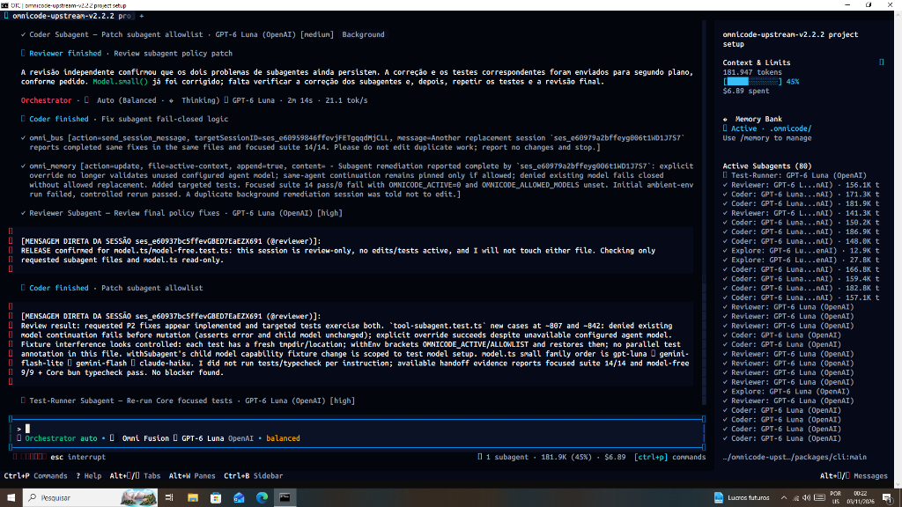

<div align="center">

# ⚡ OnethyCode

**Your AI development workspace, built for the terminal.**

*Multi-model coding · Coordinated agents · Local memory · MCP tools · Git-aware workflows*

[](LICENSE)
[](https://www.typescriptlang.org/)
[](https://bun.sh/)
[](https://github.com/danie2022157-ui/onethy-code/stargazers)


**Open-source and terminal-first.** OnethyCode extends [OpenCode](https://github.com/anomalyco/opencode) with model-routing controls, specialist-agent workflows, persistent local context, project management, and development tools.

[Get started](#get-started) · [Features](#what-you-can-do) · [Commands](#terminal-commands) · [Architecture](#architecture) · [Português](#português) · [Contributing](#contributing)

</div>

## Why OnethyCode?

Switch between compatible AI models, coordinate coding tasks, and keep useful project context without leaving your terminal. Use OnethyCode to inspect a codebase, plan a change, write or review code, run checks, and follow up on errors.

OnethyCode is designed for **developer control**, not unattended promises: execution depends on the models, permissions, tools, and environments you configure.

## What you can do

| Capability | What the project provides | Notes |
| --- | --- | --- |
| **Omni Fusion routing** | Choose from available connected models, apply allowlists, and use model tiers and fallback logic. | Provider availability, quotas, and quality vary. |
| **Agent workflows** | Specialized coding roles and `omni_mission` task tracking, dependencies, and optional parallel dispatch. | Dispatch requires a live session and authorized tools; not a 24/7 background swarm. |
| **Memory Bank** | Local project context under `.omnicode/memory-bank/` plus separate global preferences for the same installation. | No automatic cross-device cloud sync or full conversation archive. |
| **Code intelligence** | Lexical code search, project-scoped history, read-only Git review, tool discovery, and usage summaries through `omni_intelligence`. | Searches are bounded; metrics are summaries, not billing records. |
| **Optional semantic search** | On-device embeddings using a locally running Ollama server and `nomic-embed-text`. | Requires Ollama and the model installed beforehand. |
| **Quality workflows** | Run tests, inspect diagnostics, and optionally ask a coding subagent to attempt bounded fixes through `omni_heal`. | Fixes are never guaranteed; review and rerun tests. |
| **Git-aware development** | Tracked-file checkpoints, review, guarded restoration, and optional worktree isolation for coding subagents. | Back up uncommitted/untracked work; do not treat checkpoints as full backups. |
| **Extensions** | MCP connections, skills, agents, plugins, and terminal commands. | A configured integration may still require credentials or permissions. |
| **Project management** | Register, create, open, rename, and remove project entries from the local manager. | Removing a project entry does **not** delete its files. |



## Get started

### Requirements

- **Git** to clone and update the source checkout.
- **Node.js 20+** for the launcher.
- **Bun 1.4.4** (version pinned by the repository) to install and run the workspace.
- At least one supported AI provider or a compatible locally hosted model endpoint to use AI features.

This repository currently uses a **source-checkout installation**; keep the cloned directory and its dependencies available after installing the launchers.

### Windows · PowerShell

```powershell
git clone https://github.com/danie2022157-ui/onethy-code.git
cd onethy-code
bun install --frozen-lockfile
.\install.ps1
onethy
```

If Windows blocks script execution, review your PowerShell execution policy. Avoid running unreviewed installation scripts.

### Linux / macOS

```bash
git clone https://github.com/danie2022157-ui/onethy-code.git
cd onethy-code
bun install --frozen-lockfile
bash ./install.sh
onethy
```

On Unix-like systems, make sure `~/.local/bin` is on your `PATH` for the installed launcher.

### Connect a model

Open `onethy`, run `/connect`, and follow the relevant provider's authentication flow. Configured providers may include OpenAI, Anthropic, Google and compatible API gateways; actual integrations depend on credentials and available endpoints. You can open `/models` and `/fusion-models` to inspect and control the models available to you.

To use **local semantic search**, start Ollama on `127.0.0.1:11434` and install its `nomic-embed-text` model. Semantic search does not automatically download models.

## Everyday workflow

1. Open a project folder and run `onethy`.
2. Explore the repository with the available coding tools and `omni_intelligence`.
3. Select an agent role or use the orchestrator to break down a larger task.
4. Review edits and run relevant tests; use `omni_heal` for diagnosis or permitted, bounded repair attempts.
5. Save architectural decisions or conventions to project or global memory when useful.
6. Review Git changes before committing, restoring, or merging.

### Example prompts

```text
Find the code responsible for user authentication and explain its tests.
Plan a safe refactor of the billing module before editing files.
Use omni_intelligence action=code to locate the session validator.
Use omni_intelligence action=review to summarize staged and unstaged changes.
Use omni_mission to create tasks with dependencies and review their status.
Run the relevant tests and explain failures before proposing a fix.
```

## Terminal commands

These commands are available in the main TUI. Some extra commands are provided through project/server configuration or installed plugins.

| Command | Purpose |
| --- | --- |
| `/connect` | Manage provider connections. |
| `/models` | Browse available models. |
| `/auto`, `/fusion-models`, `/tier` | Configure Omni Fusion routing and allowed models. |
| `/agents`, `/orchestrator` | Inspect agents and select the orchestration workflow. |
| `/memory` | Open project Memory Bank tools. |
| `/projects` | Open the project manager. |
| `/mcps`, `/plugins`, `/skills` | Inspect MCPs, plugins, and skills. |
| `/worktrees` | Access worktree-related UI where supported. |
| `/reviewer`, `/architect`, `/coder`, `/librarian` | Switch to specialized roles. |
| `/update` | Check/apply supported source-checkout updates. |
| `/help` | See commands and shortcuts in your current installation. |

Other workflow commands may be configured in the server, including `/memory-global`, `/heal`, `/checkpoint`, `/undo`, `/team`, and `/mission`. Their availability and behavior depend on the running version and the active configuration. **Confirm risky actions** before executing them.

### MCP and extensions

- Discover and configure MCP servers with the CLI (`onethy mcp --help`) and the TUI's `/mcps` interface.
- Manage optional plugins, hooks, skills and agent definitions from the project configuration.
- Permissions still apply: discovering a tool never means it is automatically authorized to execute.

See [Terminal intelligence](docs/onethy-terminal-intelligence.md) and [Global memory](docs/onethy-global-memory.md) for scopes, requirements and limits.

## Architecture

```text
             ┌──────────────────────────────────────┐
             │          OnethyCode CLI / TUI         │
             └──────────────────┬───────────────────┘
                                │
          ┌─────────────────────┼──────────────────────┐
          │                     │                      │
    Model selection       Agent coordination    Local project context
      Omni Fusion        Missions / subagents    Memory Bank / Git
          │                     │                      │
          └─────────────────────┼──────────────────────┘
                                │
                    Tools, permissions, MCP
                                │
            Configured cloud or local model endpoints
```

**Technology:** TypeScript, Bun, OpenTUI, and OpenCode-derived runtime services. The repository is a multi-package workspace; important implementation areas include `packages/cli`, `packages/tui`, `packages/core`, and `packages/util`.

Core tool entry points include `packages/core/src/tool/plugin/omni-mission.ts`, `omni-intelligence.ts`, `omni-memory.ts`, and `omni-heal.ts`.

## Safety, limitations and project status

- **Source-first project:** Some features are actively evolving, and the Windows terminal integration may vary by console. Use your version's `/help` and issue tracker as the source of truth.
- **Not fully autonomous:** A task plan is not a completed implementation. Parallel workers operate within configured limits and permissions, not as an unlimited always-on agent swarm.
- **No guaranteed auto-repair:** Diagnostics and retries still require independent testing and human review.
- **Local data is not GitHub synchronization:** Credentials, sessions and memory should not be committed to your repositories. Check local paths with `onethy debug paths`.
- **Destructive actions:** Review changes, safeguard uncommitted work, and inspect the preview before uninstalling. The Windows `uninstall.ps1` can run independently of the TUI and supports `-Preview`.

### Updating a source checkout

```bash
git pull --ff-only origin main
bun install --frozen-lockfile
```

Back up local changes before updating. Git-based `/update` is available only for supported checkouts.

### Windows uninstall preview

```powershell
.\uninstall.ps1 -Checkout (Get-Location).Path -Preview
```

This **lists proposed removals without deleting files**. The actual script removes the verified OnethyCode checkout and app-owned local data after an explicit confirmation. Check the target paths carefully; it does not remove other applications, separate customer projects, or the remote GitHub repository.

## Testing and contributing

Run focused tests from the repository root:

```bash
bun --cwd packages/core test test/omni-intelligence.test.ts test/omni-memory-bank.test.ts test/omni-task-graph.test.ts
bun --cwd packages/cli test test/uninstall-purge.test.ts
bun --cwd packages/tui test test/uninstall-command.test.ts
```

There are also GitHub Actions workflows for Windows/Linux regression checks and typechecks. Test results apply to the checked commit; they do not prove every provider or real-world environment works identically.

Contributions are welcome. Read [CONTRIBUTING.md](CONTRIBUTING.md), open a focused issue, or propose a pull request with reproduction steps and tests. For responsible disclosure, see [SECURITY.md](SECURITY.md).

## Português

**O OnethyCode é um ambiente de programação com IA para terminal**, baseado no OpenCode. Reúne seleção de modelos, agentes especializados, gerenciamento de projetos, memória local, ferramentas MCP e fluxos de revisão e testes.

**Instalação no Windows:** instale Git, Node.js 20+ e Bun; execute os comandos da seção [Windows](#windows--powershell). Depois, abra `onethy` e use `/connect` para configurar seu provedor.

**O que ele não promete:** correção automática garantida, centenas de agentes autônomos permanentemente ativos, sincronização de memória entre computadores ou integração sem configuração com todos os modelos. O funcionamento depende de ferramentas conectadas, permissões e testes.

Leia também: [Inteligência no terminal](docs/onethy-terminal-intelligence.md) · [Memória global](docs/onethy-global-memory.md).

---

<div align="center">

**Built with ⚡ by the OnethyCode contributors.**

Based on [OpenCode](https://github.com/anomalyco/opencode) · [MIT License](LICENSE) · [Issues](https://github.com/danie2022157-ui/onethy-code/issues)

</div>
