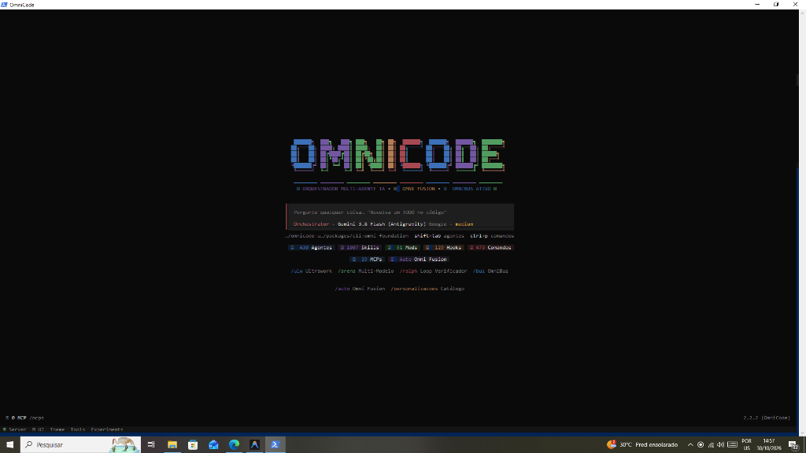
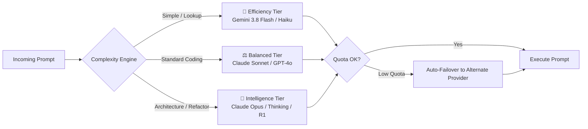
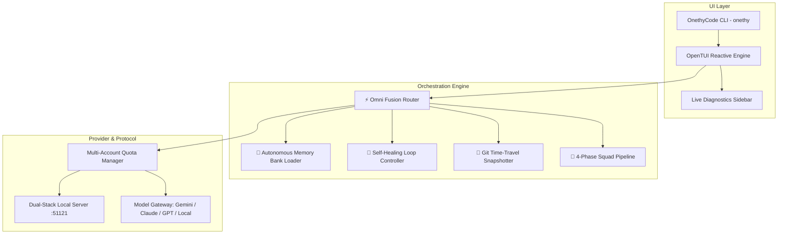

<div align="center">

# ⚡ OnethyCode

### *The Autonomous Multi-Agent AI Coding Platform with Omni Fusion & Self-Healing*

[](https://github.com/danie2022157-ui/onethy-code/stargazers)
[](https://opensource.org/licenses/MIT)
[](https://bun.sh)
[](https://www.typescriptlang.org/)
[](https://github.com/danie2022157-ui/onethy-code)

<br />

<p align="center">
  
</p>

<p align="center">
  
</p>

<p align="center">
  <b>OnethyCode</b> turns your terminal into a collaborative AI engineering squad.<br />
  Featuring <b>Omni Fusion</b> (dynamic multi-model auto-routing), <b>Autonomous Memory Bank</b>, <b>Self-Healing Test Loops</b>, and <b>430+ preloaded specialized agents</b>.
</p>

[Quickstart](#-quickstart) • [How to Use Guide](#-step-by-step-how-to-use-guide) • [Omni Fusion Deep Dive](#-onethy-fusion-model-router) • [Memory Bank](#-autonomous-memory-bank) • [Comparison](#-feature-matrix) • [Commands](#-interactive-slash-commands) • [Guia em Português](#-guia-em-português)

---

</div>

## 📑 Table of Contents

- [🌟 Why OnethyCode?](#-why-onethy-code)
- [📊 Feature Comparison Matrix](#-feature-matrix)
- [🚀 Quickstart](#-quickstart)
  - [Windows Installation](#-windows-powershell)
  - [Linux & macOS Installation](#-linux--macos-bash)
  - [Connecting Models in 1-Click](#-connecting-models)
- [📖 Step-by-Step How to Use Guide](#-step-by-step-how-to-use-guide)
  - [1. Launching OnethyCode](#1-launching-onethy-code)
  - [2. Daily Prompting & Auto-Routing](#2-daily-prompting--auto-routing)
  - [3. Filtering Models with `/fusion-models`](#3-filtering-allowed-models-with-fusion-models)
  - [4. Autonomous Project Memory Bank](#4-autonomous-project-memory-bank)
  - [5. Autonomous Self-Healing Test Loop (`/heal`)](#5-autonomous-self-healing-test-loop-heal)
  - [6. Time-Travel Checkpoints & Instant Rollback (`/undo`)](#6-time-travel-checkpoints--instant-rollback-undo)
  - [7. Full Engineering Squad Orchestration (`/team`)](#7-full-engineering-squad-orchestration-team)
- [⚡ Omni Fusion Deep Dive](#-onethy-fusion-model-router)
- [🧠 Autonomous Memory Bank Architecture](#-autonomous-memory-bank)
- [⌨️ Interactive Slash Commands & Keybindings](#-interactive-slash-commands)
- [🏗️ System Architecture](#-system-architecture)
- [❓ Frequently Asked Questions (FAQ)](#-frequently-asked-questions-faq)
- [🇧🇷 Guia em Português](#-guia-em-português)
- [🗺️ Roadmap to 100k Stars](#-roadmap-to-100k-stars)
- [🤝 Contributing](#-contributing)

---

## 🌟 Why OnethyCode?

Most AI coding tools lock you into a single provider, suffer from context amnesia across terminal sessions, or hallucinate silently when a build fails. **OnethyCode is built from the ground up as an autonomous multi-agent platform designed to address these core problems**:

1. **Eliminate Rate-Limit & Quota Halts**: Omni Fusion dynamically routes requests across Gemini 3.8 Flash, Claude 3.7 Sonnet/Opus, and GPT models based on complexity and remaining quota. If one account exhausts quota, OnethyCode fails over automatically.
2. **Never Re-explain Your Architecture**: The 4-layer Autonomous Memory Bank automatically documents your requirements, coding conventions, tech stack, and sprint context in `.onethy-code/memory-bank/`.
3. **Verified Working Code**: The `/heal` loop detects test/build errors, diagnoses root causes, modifies source code, and re-runs the compiler until tests pass.
4. **Fearless AI Edits**: Instant Git snapshots are created before major edits. Execute `/undo` at any point to restore your workspace to its exact prior state.
5. **Lightning Performance**: Written in TypeScript and powered by Bun 1.4+, launching in milliseconds with low memory overhead.

---

## 📊 Feature Matrix

| Capability | Vanilla OpenCode | Claude Code | Cursor IDE | Aider | ⚡ OnethyCode |
| :--- | :---: | :---: | :---: | :---: | :---: |
| **Multi-Model Dynamic Routing (Omni Fusion)** | ❌ | ❌ | ❌ | ❌ | **✅ Yes (44+ Models)** |
| **Model Whitelisting & Selection UI** | ❌ | ❌ | ❌ | ❌ | **✅ Yes (`/fusion-models`)** |
| **Automatic Memory Bank (Zero Prompting)** | ❌ | ❌ | ❌ | ❌ | **✅ Yes (4-layer sync)** |
| **Self-Healing Test/Build Loop** | ❌ | ❌ | ❌ | Basic | **✅ Yes (`/heal`)** |
| **Time-Travel Checkpoints & Instant Undo** | ❌ | ❌ | ❌ | Git only | **✅ Yes (`/checkpoint`, `/undo`)** |
| **Multi-Agent 4-Phase Squad Pipeline** | ❌ | ❌ | ❌ | ❌ | **✅ Yes (`/team`)** |
| **Preloaded Agents, Skills & Mods** | 2 Agents | 1 Agent | N/A | N/A | **✅ 430+ Agents, 1,000+ Skills** |
| **Automated Dual-Stack OAuth Loopback** | ❌ | ❌ | N/A | N/A | **✅ 1-Click Browser Sync** |
| **1-Command Terminal Installer** | ❌ | ❌ | ❌ | ❌ | **✅ Yes (`install.ps1`, `install.sh`)** |

---

## 🚀 Quickstart

### 🪟 Windows (PowerShell)
Open PowerShell (as normal user or Administrator) and run:
```powershell
irm https://raw.githubusercontent.com/danie2022157-ui/onethy-code/main/install.ps1 | iex
```
*Or clone and install locally:*
```powershell
git clone https://github.com/danie2022157-ui/onethy-code.git
cd onethy-code
.\install.ps1
```

### 🐧 Linux & 🍎 macOS (Bash)
Open your terminal and run:
```bash
curl -fsSL https://raw.githubusercontent.com/danie2022157-ui/onethy-code/main/install.sh | bash
```

### 🔑 Connecting Models
Once installed, connect your preferred AI providers:
1. Launch OnethyCode by typing `onethy`.
2. Type `/connect` (or `Ctrl+P` → *Conectar integração*).
3. Select **Google (Antigravity)**, **Anthropic**, **OpenAI**, or **OpenRouter**.
4. With Google Antigravity, click **OAuth with Google**: your browser opens, you approve access, and the local dual-stack listener binds automatically with zero copy-pasting required!

---

## 📖 Step-by-Step How to Use Guide

### 1. Launching OnethyCode
Navigate to any project repository and run:
```bash
onethy
```

<p align="center">
  
</p>

OnethyCode automatically inspects your repository structure, discovers your active git branch, detects installed dependencies, and initializes the **Autonomous Memory Bank**.

---

### 2. Daily Prompting & Auto-Routing
You interact with OnethyCode using natural language in the terminal prompt. Omni Fusion inspects your request in real time:

```text
> "Adicione autenticação JWT com refresh token na rota /auth/login e crie testes unitários com vitest"
```

* **What happens behind the scenes:**
  1. **Complexity Evaluator**: Classifies the prompt as **High Complexity** (multi-file implementation + security + tests).
  2. **Memory Bank Injection**: Reads `.onethy-code/memory-bank/system-patterns.md` to match your existing JWT schema and error formatting.
  3. **Tier Selection**: Routes to **🧠 Intelligence Tier** (`Claude 3.7 Sonnet Thinking` or `Claude Opus 4`).
  4. **Atomic Checkpoint**: Takes a snapshot of your repo before modifying files.
  5. **Execution**: Generates the token verification middleware, handler, and test suite.

---

### 3. Filtering Allowed Models with `/fusion-models`
Do you want OnethyCode to use only free models, or only Claude, or restrict specific models?
1. In the chat prompt, type:
   ```text
   /fusion-models
   ```
2. An interactive checklist opens:
   - **`✓ [Usar Todos os Modelos Conectados]`**: Omni Fusion freely routes between all connected providers.
   - **`[✓] Google Gemini 3.8 Flash`** (Tier: Eficiência)
   - **`[✓] Claude 3.5 Sonnet`** (Tier: Balanceado)
   - **`[✓] Claude Opus 4 Thinking`** (Tier: Inteligência)
   - **`[○] GPT-4o Mini`** (Desmarcado)
3. Press `Enter` to toggle any model on or off.
4. The sidebar instantly updates in real time:
   `⚡ Omni Fusion (3 selecionados)` · `Filtro: 3 de 44 modelos`.

---

### 4. Autonomous Project Memory Bank
OnethyCode maintains a living memory of your codebase in `.onethy-code/memory-bank/`:

```text
.onethy-code/memory-bank/
├── project-brief.md      # Core product vision, features, and non-negotiables
├── system-patterns.md    # Architecture blueprints, naming rules, design patterns
├── tech-context.md       # Frameworks, versions, database schemas, environments
└── active-context.md     # Current sprint objectives, WIP changes, next steps
```

* **How it works:** Whenever you ask OnethyCode to build or refactor features, it references these documents automatically. When significant architectural decisions are made, OnethyCode updates the memory bank seamlessly.
* **To inspect memory status:** Type `/memory` in chat.

---

### 5. Autonomous Self-Healing Test Loop (`/heal`)
Stop debugging compiler and test errors by hand:
1. Type `/heal` in chat.
2. OnethyCode detects your package manager and test runner (`bun test`, `pnpm test`, `pytest`, `cargo test`, `go test`).
3. Executes the test suite and captures stack traces.
4. **Self-Healing Loop**:
   - Isolates the failing assertion or compilation error.
   - Edits the source code to resolve the defect.
   - Re-runs the test suite.
   - Loops until 100% of tests pass.

---

### 6. Time-Travel Checkpoints & Instant Rollback (`/undo`)
Before allowing an AI agent to perform complex refactors:
1. Type `/checkpoint` to snapshot the repo.
2. Let the agent perform edits across dozens of files.
3. Don't like the result? Type:
   ```text
   /undo
   ```
4. OnethyCode reverts your workspace to the exact git commit prior to the command, leaving uncommitted user changes intact.

---

### 7. Full Engineering Squad Orchestration (`/team`)
When tackling major feature initiatives, single-agent prompting often misses edge cases. Run:
```text
/team "Construir sistema de faturamento com Stripe, webhook idempotente e painel de assinaturas"
```
OnethyCode orchestrates a 4-phase autonomous pipeline:
* **Phase 1 — `@planner`**: Deconstructs requirements into verifiable phases with quality gates.
* **Phase 2 — `@architect`**: Validates database schema, idempotency keys, and security boundaries.
* **Phase 3 — `@coder`**: Writes production code, type definitions, and test fixtures.
* **Phase 4 — `@reviewer`**: Runs security audit, checks code conventions, and ensures zero regressions.

---

## ⚡ Omni Fusion Model Router

Omni Fusion is the brain of OnethyCode. Rather than forcing you to guess which model to select for every query, Omni Fusion continuously evaluates:
* **Prompt Complexity** (syntactic depth, file count, reasoning needs).
* **Quota & Remaining Credits** (tracks Google Cloud Code, Anthropic, and OpenAI rate limits).
* **Tier Mapping**:



To manually lock a tier, use `/auto` or press `Ctrl+T` to choose:
- **Modo Auto**: Dynamic complexity selection (Recommended).
- **Eficiência**: Forces lowest latency and credit usage.
- **Balanceado**: Optimized balance of speed and precision.
- **Inteligente**: Forces deep thinking models on every query.

---

## ⌨️ Interactive Slash Commands

| Command | Aliases | Description |
| :--- | :--- | :--- |
| `/auto` | `/fusion`, `/otimizar` | Cycle or pick Omni Fusion tier (`Modo Auto`, `Eficiência`, `Balanceado`, `Inteligente`) |
| `/fusion-models` | `/modelos-fusion` | Open interactive checklist to mark allowed models or use all |
| `/memory` | `/memory-bank` | View active persistent Memory Bank state |
| `/checkpoint` | `/salvar-ponto` | Create an instant Git snapshot checkpoint |
| `/undo` | `/desfazer` | Revert workspace to previous AI checkpoint |
| `/heal` | `/autofix` | Start autonomous self-healing test and compiler fix loop |
| `/team` | `/squad` | Launch the 4-phase Planner → Architect → Coder → Reviewer pipeline |
| `/commit` | `/autocommit` | Generate conventional commit messages from git diff |
| `/personalizacoes` | `/customizations` | Open catalog of 430+ Agents, 1,000+ Skills, Mods, Hooks, and MCPs |
| `/update` | `/atualizar` | Check for updates and sync directly with the GitHub repository |
| `/connect` | `/integrations` | Connect or authenticate AI providers and MCP servers |

### Essential Keyboard Shortcuts
* `Ctrl + P`: Open Command Palette (search all commands, agents, and tools).
* `Ctrl + T`: Switch model variant / Omni Fusion tier.
* `Shift + Tab`: Cycle through autonomous specialist agents (`@coder`, `@architect`, `@planner`, `@reviewer`, `@librarian`).
* `Esc`: Close open modal dialogs.

---

## 🏗️ System Architecture



---

## ❓ Frequently Asked Questions (FAQ)

#### Q: Are my credentials or API keys uploaded to GitHub?
**A: Absolutely not.** All user credentials, tokens, and OAuth keys reside strictly in your operating system's local application data directory (`%APPDATA%/onethy-code` on Windows, `~/.config/opencode` on Linux/macOS). The OnethyCode repository has zero access to your private credentials.

#### Q: How does Google Antigravity OAuth work?
**A: 1-Click Zero Setup.** When you connect Google in OnethyCode, a lightweight background server starts on `0.0.0.0:51121`. You log in via your browser, approve access, and the token exchanges automatically with no manual copy-pasting of redirect URLs.

#### Q: Can I use OnethyCode completely offline or with local models?
**A: Yes.** OnethyCode supports local endpoints via OpenAI-compatible APIs (Ollama, vLLM, LM Studio, LocalAI). Configure your base URL in `~/.config/opencode/opencode.json` and Omni Fusion will route to your local GPUs.

#### Q: How do I update OnethyCode?
**A: Run `/update` in chat** or run `git pull origin main` in the checkout directory. OnethyCode's built-in updater syncs with GitHub and preserves your local settings.

---

## 🇧🇷 Guia em Português

### Instalação Rápida no Windows:
Abra o PowerShell e cole:
```powershell
irm https://raw.githubusercontent.com/danie2022157-ui/onethy-code/main/install.ps1 | iex
```

### Como Usar no Dia a Dia:
1. Abra qualquer pasta de projeto no terminal e digite:
   ```bash
   onethy
   ```
2. **Conectar seus modelos**: Digite `/connect` e escolha Google Antigravity, Anthropic ou OpenAI.
3. **Omni Fusion**: O OnethyCode escolhe automaticamente o melhor modelo para cada pergunta (Gemini 3.8 Flash para tarefas rápidas, Claude 3.7 Sonnet para código balanceado, Opus para arquitetura).
4. **Filtrar Modelos**: Digite `/fusion-models` para marcar apenas os modelos que você quer usar.
5. **Autocura de Código**: Se seus testes ou build quebrarem, digite `/heal` e a IA conserta o código sozinha até passar em todos os testes.
6. **Desfazer Alterações**: Digite `/undo` para voltar o código ao estado anterior a qualquer momento.
7. **Equipe Completa**: Digite `/team "sua funcionalidade"` para acionar o time de 4 agentes (Planejador, Arquiteto, Programador e Revisor).

---

## 🗺️ Roadmap to 100k Stars

- [x] **v2.2.0**: Native Omni Fusion complexity router & tier selector.
- [x] **v2.2.1**: Persistent Memory Bank automatic loader & time-travel undo.
- [x] **v2.2.2**: Model filtering checklist dialog (`/fusion-models`) & live sidebar diagnostics.
- [x] **v2.2.2**: 1-Click automated Google Antigravity OAuth with dual-stack loopback.
- [x] **v2.2.2**: Dedicated `/update` GitHub synchronizer & offline installer.
- [ ] **v2.3.0**: Native zero-setup Ollama / vLLM local model discovery.
- [ ] **v2.4.0**: Distributed peer-to-peer agent pairing across local networks.
- [ ] **v2.5.0**: VS Code & Cursor IDE extension bridge.
- [ ] **v2.6.0**: Web-based visual dashboard for multi-agent execution traces.

---

## 🤝 Contributing

We welcome issues, feature suggestions, and PRs!
1. Fork the project (`https://github.com/danie2022157-ui/onethy-code`)
2. Create your feature branch (`git checkout -b feat/amazing-feature`)
3. Commit your changes (`git commit -m 'feat: add amazing feature'`)
4. Push to your branch (`git push origin feat/amazing-feature`)
5. Open a Pull Request!

---

<div align="center">

### ⭐ Star us on GitHub — It helps OnethyCode reach more developers!

Made with ⚡ by [Daniel](https://github.com/danie2022157-ui) and the open source community.

</div>
