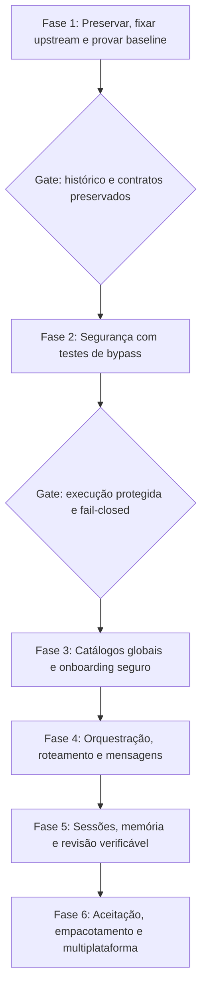

# OmniCode — Plano de Implementação e Arquitetura por Etapas

> **For agentic workers:** REQUIRED SUB-SKILL: Use `executing-plans` ou `subagent-driven-development` somente quando o usuário autorizar a implementação. As etapas usam checkboxes para acompanhar resultados comprovados, não apenas código escrito.

**Goal:** construir uma CLI de programação multiagente sobre um fork independente do OpenCode, com configuração global, aprovações reais e memória entre sessões.

**Architecture:** preservar o protótipo e o histórico existentes; preparar a base upstream separadamente; reutilizar seus provedores, TUI, protocolos e persistência. Adicionar a camada Omni com políticas centrais de execução e catálogos escopados, sem reconstruir recursos upstream já disponíveis.

**Tech Stack:** TypeScript e monorepo OpenCode V2; Bun `1.4.4`, conforme o `packageManager` da base consultada; SQLite para persistência. O protótipo Node.js/ESM continua separado.

**Spec:** [Visão e análise do projeto](../specs/2026-10-29-omni-orchestrator-design.md)

**Identidade:** OmniCode; comandos `omni` e `omnicode`; sem afiliação com a equipe OpenCode.

**Data:** 2026-10-29.

**Status:** plano corrigido para revisão. Esta edição documental **não autoriza nem inicia execução, migração ou correções no código**.

## Global Constraints

- Usar um **fork independente do repositório oficial**, não um produto “oficial” da equipe OpenCode.
- Base fixada: OpenCode **`v2.2.2`**, commit **`098aa7fd6e02b03d6fc410f0b052038c7d4c5e81`**, release não preliminar publicada em 2026-10-29; manter os avisos MIT e os créditos.
- Não seguir `latest` nem `dev` automaticamente. Toda atualização upstream exige nova validação do contrato de comandos, políticas e migrações.
- Preservar código, `prototype/`, documentação, arquivos ignorados e histórico Git existentes; não sobrescrever, resetar, mover ou apagar durante esta revisão.
- Não fazer commit, push, publicação, instalação global ou alteração em configurações reais do usuário sem solicitação específica.
- Manter `approve` como padrão. Modo/ação desconhecido, aprovação indisponível, erro ou timeout de aprovação resultam em **negação**, nunca em permissão implícita.
- Configuração global dá disponibilidade em todos os projetos OmniCode, não acesso irrestrito a todos os agentes nem compatibilidade automática com outros aplicativos.
- Não colocar chaves em JSON, JSONC, prompts, histórico, logs ou exportações; usar cofre do sistema ou referência a variável de ambiente.
- Testes acompanham **todas as fases**, começando pelas barreiras de segurança. Nada de deixar testes só para o final.
- Meta de cobertura: pelo menos 80% nas novas unidades Omni mensuráveis, sem substituir testes de integração, de bypass e de fluxos críticos.

## Review Focus

1. Caminhos inexistentes, links simbólicos/junctions, raízes com prefixos parecidos, volumes diferentes e troca de link entre validação e escrita não podem permitir escape.
2. Shells executam código arbitrário: `cwd` e listas de prefixos não são sandbox; testes de comandos, scripts e subprocessos precisam verificar os efeitos reais.
3. Ausência de interface interativa, cancelamento, negação rígida e falha de hook não podem transformar `approve`/`smart` em `auto`.
4. Trocar agente/modelo, enviar mensagem ou chamar MCP/plugin não pode ampliar permissões nem contornar o despacho central.
5. Atualização, desinstalação, autenticação, sessões e testes do fork não podem atingir a instalação OpenCode nem dados reais de outros projetos.

## 1. Estado observado e decisões do plano

### 1.1. Não partir de premissas antigas

Revalidação somente leitura no commit local `3415987aef56cb566f85fd4023e664373cc5fc04`:

- O diretório **já possui Git**, branch `master`, histórico local, remoto `upstream`, `prototype/` e os binários `omni`/`omnicode`.
- Há `tests/security_and_modes.test.js` e script `npm test`; a existência deles não comprova cobertura nem segurança. A suíte **não foi executada nesta revisão documental**.
- Existem `src/core/security.js`, `config_manager.js`, `reviewer.js` e `init_helper.js`; precisam de avaliação e migração, não de recriação automática.
- `/diff`, `/undo`, `/compact`, `/connect` e `/export` têm handlers em `src/index.js`. Suas limitações precisam de testes; não devem ser descritos como comandos inexistentes.
- Remoto upstream e mudança de nome no `package.json` **não provam que a árvore local é um fork do runtime OpenCode**.

### 1.2. Decisões técnicas explícitas

| Tema | Decisão para a implementação futura |
| --- | --- |
| Base | Fork independente de `v2.2.2` no commit fixado acima; manter o monorepo, não substituí-lo por um `package.json` único do protótipo. |
| Autonomia | `approve` por padrão; `plan`, `smart` e `auto` selecionáveis. `build` é papel de agente, não um quinto modo que ignore políticas. |
| Compatibilidade | Meta de paridade com os comandos **da versão fixada**, inclusive operacionais, com testes por comando; não promessa de robustez automática ou de compatibilidade com futuras versões. |
| Sessões | Reutilizar o armazenamento **SQLite do runtime**, sob namespace/diretório de dados OmniCode; JSONL serve apenas para importação/exportação, não para outro banco concorrente. |
| Credenciais | Cofre do sistema operacional quando disponível; variáveis de ambiente em ambientes sem cofre. Nenhum fallback silencioso para arquivo de segredos em texto puro. |
| Testes | TDD nas novas regras/comportamentos; provas de regressão em cada fase; validação multiplataforma antes da liberação. |

## 2. Escopos, diretórios e precedência

### 2.1. Um padrão por finalidade

| Sistema | Configuração | Dados privados: SQLite, sessões, memória e auditoria | Cache |
| --- | --- | --- | --- |
| Windows | `%APPDATA%\omnicode` | `%LOCALAPPDATA%\omnicode\data` | `%LOCALAPPDATA%\omnicode\cache` |
| Linux e macOS | `${XDG_CONFIG_HOME:-~/.config}/omnicode` | `${XDG_DATA_HOME:-~/.local/share}/omnicode` | `${XDG_CACHE_HOME:-~/.cache}/omnicode` |

Na segunda linha, a notação é descritiva, não um comando PowerShell. Aceitar valores XDG absolutos; usar os padrões quando ausentes. Overrides explícitos `OMNICODE_CONFIG_DIR`, `OMNICODE_DATA_DIR` e `OMNICODE_CACHE_DIR` devem ser absolutos e validados. Não procurar alternativamente em `~/.omnicode` de forma implícita.

Projeto: `.omnicode/omnicode.jsonc` como configuração canônica. `omnicode.jsonc` na raiz é alternativa compatível, de menor precedência. Configuração `.opencode/` é entrada de compatibilidade, carregada apenas quando o projeto for confiável; nunca modificar a configuração global de outra instalação.

### 2.2. Organização global

```text
<configuração OmniCode>/
  omnicode.jsonc      # provedores/modelos sem segredos, modos e políticas
  cli.json           # preferências da interface e atalhos
  agents/
  skills/
  commands/
  hooks/
  plugins/           # inclui mods compatíveis com o contrato do fork
```

As conexões MCP ficam em `mcp.servers` no JSONC, seguindo a forma V2. Perfis de autonomia e esforço ficam no arquivo principal. Os arquivos legados `agents.json`, `models.json`, `mcp_servers.json` e `preferences.json` são fontes de importação com prévia e confirmação, não uma segunda configuração canônica.

Separar catálogos de **provedores/modelos**, **agentes/skills/comandos** e **extensões executáveis**. Cada entrada registra origem, ID, versão, escopo e confiança; executáveis também declaram capacidades e permissões. Recursos são descobertos globalmente e carregados sob demanda, sem injetar todo o catálogo em todos os prompts.

Preferências comuns: padrão do produto → global → compatibilidade de projeto → configuração Omni do projeto → sessão. Definições com mesmo ID são resolvidas nessa ordem e mostram sua origem. **Negações rígidas globais ficam fora dessa precedência e nunca podem ser anuladas pelo projeto, agente, sessão ou plugin.** As permissões efetivas de um filho não podem exceder o escopo autorizado ao pai para a tarefa.

## 3. Roadmap em seis fases com gates



### Fase 1 — Preservação e integração real da base

**Entradas:** árvore/histórico local, `prototype/` e release upstream fixada.

**Entregas documentais na implementação:** `docs/upstream.lock.json`, `docs/upstream-map.md` e `docs/compatibility/cli-v2.2.2.json`. O lock registra repositório, tag, SHA, toolchain e licença; a matriz registra comando, flags, saída, efeito e teste correspondente.

- [ ] **1.1. Inventariar antes de alterar:** revalidar `git status`, branch/HEAD, histórico, remotos, testes e arquivos ignorados. Parar se outra ferramenta estiver escrevendo nos mesmos arquivos.
- [ ] **1.2. Preservar por cópia verificada:** manter a pasta atual intacta; produzir cópia privada com manifesto de hashes. Não mover o trabalho existente para cima de `prototype/` e não versionar `.env`, tokens ou dados de sessões.
- [ ] **1.3. Preparar checkout separado:** clonar a tag fixada em destino novo e vazio, sem mesclar históricos não relacionados nem fazer reset no repositório atual. Configurar branch de trabalho e remoto `upstream`; nenhum push nem criação de repositório remoto nesta etapa.
- [ ] **1.4. Conferir a base:** comparar `HEAD` com `098aa7fd6e02b03d6fc410f0b052038c7d4c5e81`, preservar licença/lockfile e usar Bun `1.4.4`. Não instalar globalmente sem permissão.
- [ ] **1.5. Mapear pontos reais de extensão:** `packages/cli`, `packages/core`, `packages/ai`, `packages/server` e `packages/plugin` existem na base consultada. Registrar em `upstream-map.md` os arquivos concretos de despacho, permissões, diretórios, persistência, teste e empacotamento antes de alterá-los.
- [ ] **1.6. Baseline isolado:** rodar as suítes por pacote e registrar falhas preexistentes. Não usar `bun test` ou `npm test` da raiz como substituto: o script `test` da raiz upstream recusa essa execução.
- [ ] **1.7. Branding com teste primeiro:** criar teste de binários/ajuda e de namespace isolado; observar falha; adicionar `omni`/`omnicode` no empacotamento correto do monorepo; verificar ajuda, versão e zero escrita na instalação OpenCode.
- [ ] **1.8. Congelar o contrato da CLI:** gerar a matriz a partir do `--help` recursivo da base fixada. A documentação V2 orienta a pesquisa; o código e a ajuda da tag fixada resolvem diferenças de versão.

**Gate de saída:** cópia conferida, upstream fixado, baseline com resultados registrados e mapa de integração concluído. Remoto ou banner isoladamente não concluem esta fase. A troca da pasta principal fica para uma migração posterior autorizada, não é condição para testar o fork em paralelo.

### Fase 2 — Segurança central e correção dos modos

**Superfícies de referência:** `src/core/security.js`, ferramentas de arquivo/shell, `src/index.js` e cliente MCP do protótipo. Não copiar essas implementações para o fork como se estivessem validadas. Os arquivos concretos do patch upstream são os identificados na Fase 1.

#### 2.1. Caminhos: substituir a fórmula insegura por uma política verificável

- [ ] Escrever regressões de escape antes da correção: `..`, absoluto externo, diretório irmão com prefixo parecido, link/junction externo, caminhos em volume/UNC diferente, caixa de letras em sistemas sensíveis e arquivo novo sob pai vinculado externamente.
- [ ] Canonicalizar a raiz e o alvo existente; para um arquivo novo, canonicalizar o ancestral existente mais próximo antes de validar os segmentos restantes. O resolvedor não cria diretórios ao validar.
- [ ] Verificar contenção com semântica de `path.relative` e do sistema de arquivos: relativo vazio é a raiz; relativo absoluto, `..` ou iniciado por `..` + separador é externo. **Não usar `canonicalPath.startsWith(root)` nem converter caminhos de todos os sistemas para minúsculas.**
- [ ] Validar cada caminho de um patch antes de aplicar efeitos. Tratar links/junctions e mudanças entre conferência e uso; onde a operação não puder ser protegida, negar a mutação ou exigir executor isolado. `realpath` isoladamente não elimina corridas.
- [ ] Incluir `/undo`, `/init`, `/export`, configurações e exclusões na autorização. Antes de desfazer, conferir se o arquivo não foi alterado por outra pessoa desde a edição do agente.

#### 2.2. Matriz de autonomia

| Ação | `plan` | `approve` | `smart` | `auto` |
| --- | --- | --- | --- | --- |
| Leitura não sensível em raiz autorizada | permitir | permitir | permitir | permitir |
| Gravação/exclusão no projeto | negar | pedir aprovação | pedir aprovação | permitir se política autorizar |
| Shell de inspeção com comando e argumentos comprovadamente permitidos | permitir | pedir aprovação | permitir | permitir se política autorizar |
| Teste/build ou script do projeto | negar | pedir aprovação | pedir aprovação, salvo regra explícita previamente aprovada | executar somente com isolamento/política adequada |
| Instalação, acesso sensível, publicação ou efeito remoto | negar | pedir aprovação específica | pedir aprovação específica | seguir política específica; o modo sozinho não autoriza |
| Ação desconhecida ou negada por política rígida | negar | negar | negar | negar |

Leituras sensíveis têm sua própria política. Registro interno de sessão/auditoria é separado de mutações no projeto: `plan` pode registrar a conversa em seu armazenamento privado, mas não alterar código, instruções ou preferências globais por iniciativa do agente.

- [ ] Testar e aplicar **fail-closed**: sem callback/terminal, com cancelamento, retorno inválido, timeout, erro ou modo desconhecido, uma ação que pede aprovação não executa.
- [ ] Testar hook de autorização que lança erro ou altera argumentos após aprovação: bloquear o despacho ou pedir nova aprovação, nunca continuar com a permissão anterior.
- [ ] Ligar a aprovação ao agente, projeto, ação, argumentos e prévia/diff específicos. Se hook ou código alterar o pedido, a autorização anterior não pode aprovar uma operação diferente.
- [ ] Testar que a troca de modelo/agente, a delegação e mensagens recebidas não elevam permissões nem contam como aprovação do usuário.
- [ ] Encaminhar ferramentas nativas, MCP e comandos com efeitos pela mesma avaliação. Hooks/plugins executáveis têm confiança explícita e isolamento ou são tratados como código privilegiado; instalar um plugin não pode ser vendido como execução automaticamente segura.

#### 2.3. Shell não é sandbox

- [ ] Testar escapes por caminho absoluto nos argumentos, redirecionamento, comandos compostos, substituição de comandos, scripts, `git -C` e subprocessos. Um teste pode executar código arbitrário; não classificá-lo como seguro apenas pelo nome `test`.
- [ ] Reutilizar o analisador upstream onde aplicável; negar sintaxe não analisável em vez de aprová-la por prefixo. Exemplos como `git branch -D` não são leitura só porque começam com `git branch`.
- [ ] Separar permissão de execução e isolamento do SO/container. Validar `cwd` não impede um programa de acessar outros caminhos ou a rede.
- [ ] Em plataforma sem isolamento suficiente, **desabilitar shell arbitrário sem supervisão no modo `auto`**; exibir a limitação e pedir aprovação ou usar executor isolado. Não relaxar a política silenciosamente para manter a tarefa andando.
- [ ] Testar limites de tempo/saída, interrupção e encerramento de subprocessos; não repetir automaticamente comandos com efeitos cuja conclusão ficou incerta.

#### 2.4. Credenciais e demonstração

- [ ] Testar credencial ausente e modelo inválido como erros reais; demonstração só com `--demo`/`--simulate` ou ação explícita correspondente.
- [ ] Em demonstração, usar fixture/executor isolado com indicação permanente e sem cobranças nem efeitos nos arquivos reais do projeto.
- [ ] Sanitizar logs, diffs exibidos, erros e exportações; mostrar apenas presença de credencial, nunca prefixo/sufixo. Redação de segredos não equivale a garantir ausência de qualquer informação sensível.

**Gate de saída:** regressões RED→GREEN, testes de integração cobrindo cada caminho de execução e todas as negações da matriz, sem falha aberta. Os testes de segurança são obrigatórios nesta fase; a Fase 6 apenas os consolida em mais plataformas.

### Fase 3 — Catálogos globais e onboarding seguro

- [ ] Escrever testes de resolução de diretórios, colisões de ID, precedência e negações rígidas antes de implementar o resolvedor dos escopos da seção 2.
- [ ] Reaproveitar/adaptar os carregadores V2 de agentes, skills, comandos, plugins/hooks e MCP. Testar dois projetos distintos: recursos globais disponíveis em ambos; dados e permissões de um projeto não aparecem no outro.
- [ ] `omni configure` permite escolher provedor/modelo, esforço e modo; `approve` permanece padrão até escolha explícita. Não anunciar Gemini ou outro serviço como grátis sem confirmação atual de plano e região.
- [ ] Inserção de segredo com entrada mascarada, fora do prompt/histórico do agente. Guardar apenas referência no JSONC e o valor no cofre do SO; no CI/headless, usar variáveis de ambiente. Não inventar “chaves criptografadas” num JSON sem projeto de gestão das chaves de criptografia.
- [ ] Importação de `.env`/configuração antiga é opt-in, com prévia sem valores secretos; não apagar o original nem promover automaticamente configuração de um repositório para o escopo global.
- [ ] Testar cofre indisponível, credencial revogada e autenticação cancelada. OAuth só por integração autorizada pelo provedor, sem reaproveitar tokens/clientes de outra aplicação por suposição.

**Gate de saída:** onboarding testável sem conta paga, usando credenciais falsas e providers locais de teste; nenhum teste grava no cofre, perfil ou diretório real do usuário.

### Fase 4 — Orquestração, capacidades e colaboração

- [ ] Definir tarefas com ID, dependências, critério de conclusão, agente, limite e estado; testar ciclo de dependências, falha, bloqueio e cancelamento antes do scheduler.
- [ ] Reutilizar o catálogo upstream; filtrar disponibilidade/autorização, tool calling, modalidades, entrada/saída, limite de contexto e esforço suportado **antes** de pontuar custo/latência/complexidade. Modelo fixo incompatível falha claramente.
- [ ] Explicar a escolha e permitir override. Não fixar modelos antigos como Claude 3.7, o1/o3-mini ou GPT-4o na arquitetura; IDs e parâmetros vêm do catálogo e do adaptador atual do provedor. Esforço é normalizado só quando suportado.
- [ ] Implementar mensagens com remetente/destinatário, projeto, sessão, tarefa, ID, correlação e versão. `payload` deve ser união discriminada validada por schema, não `any` executável.
- [ ] Deduplicar entregas e limitar tamanho, frequência e passos para evitar loops de conversa. Uma mensagem não autoriza ferramentas, aprovações nem mudanças de política.
- [ ] Escrita concorrente só em worktrees isoladas; testar conflitos de integração e ausência de Git. Sem isolamento disponível, usar escrita sequencial. Integração pelo supervisor passa pelas mesmas políticas e não faz push automaticamente.
- [ ] Testar interrupção, orçamento e tarefas parcialmente concluídas; não emitir “missão concluída com sucesso” se houver subtarefa falha/bloqueada ou verificação obrigatória ausente.

**Gate de saída:** tarefa pequena ponta a ponta com dois agentes/modelos simulados para testes, rastreabilidade e resultado real no projeto de fixture; smoke real com provedor apenas quando autorizado.

### Fase 5 — Sessões, memória e revisão com evidências

- [ ] Reutilizar o **SQLite do runtime** com namespace OmniCode no diretório de dados privado. Não criar outro sistema paralelo sob `.omnicode/sessions/` nem escolher entre SQLite/JSONL durante a execução.
- [ ] Acrescentar campos/tabelas Omni via migrações versionadas, testadas com backup/restauração; não duplicar transcrições já persistidas pelo runtime.
- [ ] Manter `session` upstream e adicionar `resume`/`branch` sem colisões; testar retomada após reinício, cancelamento, exportação/importação e concorrência. Ramificar conversa não equivale a copiar ou restaurar arquivos.
- [ ] Separar histórico, preferências do usuário, memória do projeto e memória opcional de agente por ID estável de projeto. Trocar de modelo mantém sessão/memória, mas nunca amplia seu escopo.
- [ ] Oferecer consulta, edição, esquecimento, modo sem persistência e retenção configurável; exportações são sanitizadas por padrão. `.omnicode/memory.md`, quando explicitamente criado para compartilhamento, não recebe memória privada automaticamente.
- [ ] Evoluir o `reviewer` já existente: testar obtenção do diff, lint/testes configurados e resposta do provedor com arquivos/linhas, sem prometer auditoria completa. Regras estáticas isoladas não substituem revisão semântica nem provam “zero vulnerabilidades”.
- [ ] Distinguir verificações `passed`, `failed`, `skipped`, `error` e execução da revisão vs aprovação do código. Testes/linters são comandos com efeitos e devem passar pelo motor de permissões; sem credencial ou sem repositório, informar a limitação e não inventar análise.

**Gate de saída:** sessão retomável em processo novo, memória recuperável sem vazamento entre projetos e relatório de revisão que reproduz resultados e falhas dos comandos realmente executados.

### Fase 6 — Aceitação, distribuição e multiplataforma

- [ ] Executar unitários, integrações e E2E CLI/TUI em Windows 11 (PowerShell/CMD), Linux (Bash) e macOS (Zsh); registrar limitações reais do upstream em vez de declarar suporte presumido.
- [ ] Validar matriz de comandos, ajuda, flags, códigos de saída, JSON streaming e atalhos existentes da tag. Preservar atalhos upstream por padrão; atalhos Omni extras não podem conflitar silenciosamente com eles nem com Enter/Ctrl+M.
- [ ] Provar que `upgrade`, `uninstall`, serviço, pairing, API e ACP pertencem ao **namespace OmniCode**. Atualizações usam artefatos OmniCode, não substituem o binário por release oficial OpenCode; sem canal Omni configurado, falhar com mensagem explícita.
- [ ] Não expor serviço à rede por padrão; testar autenticação, loopback, autorização de projetos e ausência de segredo em diagnósticos.
- [ ] Revisão de segurança independente para os patches de autorização, cobertura das novas unidades Omni, baseline upstream e checklist de dados do usuário. Falhas críticas bloqueiam liberação.
- [ ] Preparar instalador/empacotamento e instruções de recuperação. Publicação, substituição da instalação atual e limpeza de backups só após autorização específica.

**Gate de saída:** critérios da especificação demonstrados e evidências por plataforma/pacote registradas. Nenhuma alegação genérica de “100% da robustez” ou “nenhuma vulnerabilidade”.

## 4. Verificação durante a implementação — comandos e isolamento

Executar em fixture/checkout isolado, com diretórios Omni temporários e variáveis upstream relevantes isoladas também. Sem credenciais reais, rede externa ou hooks de usuário por padrão. O teste atual de `ConfigManager` chama inicialização global; não rodá-lo com o perfil real inadvertidamente.

| Base | Verificação planejada | Resultado exigido |
| --- | --- | --- |
| Protótipo, se alterado futuramente | `npm test`, com `OMNICODE_CONFIG_DIR` apontando para fixture privada | nenhum perfil real alterado; falhas registradas |
| Upstream/fork | `bun run --cwd packages/cli test` | suite CLI aprovada ou falhas baseline explicitamente identificadas |
| Upstream/fork | `bun run --cwd packages/core test` | suite core aprovada; testes novos de bypass não podem ser dispensados como baseline |
| Upstream/fork | `bun run --cwd packages/ai test` e `bun run --cwd packages/server test` | contratos de provedor/servidor preservados |
| Upstream/fork | `bun run typecheck`, `bun run lint` e `bun run --cwd packages/cli build` | saída e código de execução registrados; dependências/toolchain conferidos antes |

Os scripts upstream acima foram conferidos nos `package.json` de `v2.2.2`; **não foram executados nesta revisão**. Casos novos de permissão devem observar falha antes da correção, depois sucesso e regressão verde. Nenhuma etapa marca conclusão apenas por arquivo presente ou mensagem do agente.

## 5. Relação entre pesquisa e decisões

| Referência | Uso no plano |
| --- | --- |
| [OpenCode V2 CLI](https://opencode.ai/v2/docs/cli/commands/) | comandos e paridade por versão, sem reimplementar a TUI do zero |
| [Permissões](https://opencode.ai/v2/docs/permissions/) e [plugins V2](https://opencode.ai/v2/docs/build/plugins/server) | políticas na execução; separar catálogo, confiança e hooks |
| [Modelos V2](https://opencode.ai/v2/docs/models/) | seleção por capacidades/variantes, não por nome antigo do modelo |
| [Claude Code — memória](https://code.claude.com/docs/en/memory) e [mensagens](https://code.claude.com/docs/en/cross-session-messaging) | separar memória de histórico; mensagens não são aprovação |
| [Goose — permissões](https://goose-docs.ai/docs/guides/managing-tools/goose-permissions/) e [Chat Recall](https://goose-docs.ai/docs/mcp/chatrecall-mcp/) | modos descobríveis e recuperação de sessões |
| [Aider — modos](https://aider.chat/docs/usage/modes.html) | separar planejamento e edição, sem delegação desnecessária em tarefas triviais |
| [OpenHands — CLI](https://docs.all-hands.dev/usage/how-to/cli-mode) | retomada, confirmação e interrupção claras |

**Provas da base fixada:** [release v2.2.2](https://github.com/anomalyco/opencode/releases/tag/v2.2.2), [referência Git da tag](https://api.github.com/repos/anomalyco/opencode/git/ref/tags/v2.2.2) e [package.json da base](https://github.com/anomalyco/opencode/blob/v2.2.2/package.json). A consulta genérica `releases/latest` retornou uma release V1 na pesquisa; por isso a escolha V2 foi confirmada pela release/tag específica, não pelo rótulo `latest`.

## 6. Próximo passo — somente após autorização de execução

1. Revalidar o estado local e preservar uma cópia antes de qualquer migração.
2. Preparar o upstream fixado em checkout separado, mapear arquivos reais e comprovar baseline.
3. Implementar a Fase 2 com testes de bypass primeiro; não considerar os módulos atuais prova de segurança concluída.

Até lá, este arquivo é apenas o plano corrigido. Nenhum módulo foi corrigido, nenhum fork foi clonado e nenhum arquivo do usuário foi movido por esta revisão.
